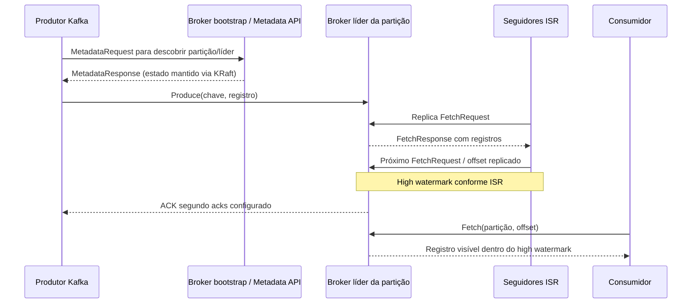

# Evidências experimentais e auditoria metodológica — M2 Tema 4 / Ênfase D

**Este arquivo registra experimentos, NÃO é o relatório acadêmico final de 15–25 páginas.** Roteiro oficial da disciplina de Sistemas Distribuídos (UNIVALI): replicação E3, falhas/quórum E5, partição E6, coordenação E8, comparativo E9 e R7 (no mínimo cinco medições com média e desvio padrão).

**Proveniência primária:** [GitHub Actions #40732373570](https://github.com/leodbc/Pub-Sub-Architecture/actions/runs/40732373570), commit **6b08f81cbd26477fdc1ab1858654a10953bb18ce**. Os cinco jobs originais foram aprovados. Kafka Native 4.4.0 e NATS JetStream 2.10, ambos com três nós. O registro preparatório foi preservado sem alterações em [historico/protocolo_pre_auditoria_2026-10-28.md](historico/protocolo_pre_auditoria_2026-10-28.md).

## E1–E2 — topologia e caminho

**Previsão:** três brokers+controllers KRaft; três nós NATS com stream RF3; produtor → líder → replicação → confirmação → consumidor conforme o protocolo. **Observação:** e1_kafka_topic.log, e1_kafka_quorum.log, e1_nats_stream.log, e2_kafka_verify.log e e2_nats_verify.log da execução histórica demonstram topologia, líderes, ISR e dados publicados/consumidos. **Limite:** não houve captura instrumentada de todos os saltos internos nem diagrama próprio; não reclassificar inferência teórica como trace de E2.

## E3 — distinguir ACK, visibilidade e propagação por réplica

**ACK:** tempo desde o envio até a resposta do produtor; varia por Kafka acks=1, Kafka acks=all e NATS PubAck. **Visibilidade ao cliente:** tempo do início do envio até o callback do consumidor, medido pelo mesmo processo com relógio monotônico e warm-up anterior aos cinco ciclos. O callback pode ser observado antes do ACK de produção. **Propagação para follower:** exige observação dos offsets/aplicação de cada réplica no tempo, com resolução conhecida. Nem ACK nem callback no consumidor padrão medem diretamente o instante de chegada a cada follower Kafka ou a cada membro Raft do JetStream. ISR, high watermark e lag/current são evidências de estado, não de latência individual de propagação. **Esta subpropriedade permanece NÃO MEDIDA diretamente**, como exige o rigor do PDF.

### E3 histórico — benchmark do produtor (n=5 por modo; média ± DP amostral)

| Modo | ACK médio ± DP (ms) | Vazão média ± DP (msg/s) | Fonte |
|---|---:|---:|---|
| Kafka acks=all | 0,764 ± 0,058 | 1.310,4 ± 97,2 | e3_kafka_acks_all.log |
| Kafka acks=1 | 0,338 ± 0,036 | 2.944,0 ± 282,7 | e3_kafka_acks_1.log |
| NATS JetStream RF3 | 0,558 ± 0,008 | 1.778,4 ± 25,2 | e3_nats_rf3.log |

### E3 complementar — ACK e callback de leitura, separadamente (n=5)

| Modo | ACK médio ± DP (ms) | Visibilidade média ± DP (ms) |
|---|---:|---:|
| Kafka acks=all | 0,818 ± 0,032 | 0,792 ± 0,028 |
| Kafka acks=1 | 0,329 ± 0,056 | 0,844 ± 0,066 |
| NATS | 0,532 ± 0,043 | 0,570 ± 0,046 |

CSV individual por modo: kafka_all.csv, kafka_1.csv e nats.csv, [artifact #12849007298](https://github.com/leodbc/Pub-Sub-Architecture/actions/runs/40764006491/artifacts/12849007298). Os 15 pares de leituras estão completos, inclusive os casos com callback anterior ao ACK. NÃO juntar a média desse novo microteste com o benchmark histórico de 200 mensagens por rodada: as cargas e medidores diferem.

## E4 — ordem

No experimento com chave fixa e 90 chaves distribuídas por três partições, e4_kafka_multi_verify.log registrou zero inversões dentro de uma partição e 71 inversões na leitura global concatenada. Isso demonstra o limite da garantia de ordenação por partição (um produtor), sem provar exactly-once ou linearizabilidade.

## E5 — matriz de nós ativos × leitura × escrita (cinco repetições)

**Classificação operacional:** confirmado pelo produtor; timeout SEM confirmação; erro de API; API de leitura respondeu com dados; API de leitura respondeu vazia. Timeout não demonstra perda definitiva de mensagens. Os arquivos de ACK usados nos verify intermediários podem se referir à última tentativa e NÃO necessariamente à mensagem confirmada antes da falha. Assim, dados lidos pela API não provam leitura de um registro identificado e confirmado.

| Sistema | Ativos | Operação | r1, r2, r3, r4, r5 |
|---|---:|---|---|
| Kafka | 3 | acks=all | confirmado × 5 |
| Kafka | 2 | acks=all | confirmado × 5 |
| Kafka | 2 | leitura API | vazio, dados, dados, vazio, dados |
| Kafka | 1 | acks=all | timeout × 5 |
| Kafka | 1 | acks=1 | timeout, timeout, confirmado, timeout, confirmado |
| Kafka | 1 | leitura API | dados, vazio, dados, vazio, dados |
| NATS | 3 | PubAck | confirmado × 5 |
| NATS | 2 | PubAck | confirmado × 5 |
| NATS | 2 | leitura API | dados × 5 |
| NATS | 1 | PubAck | timeout × 5 |
| NATS | 1 | leitura API | erro API, erro API, timeout, timeout, erro API |

A trilha por repetição e caminho de log está no CSV e5_5x_matrix.csv e em e5_matriz.md, [artifact #12848882349](https://github.com/leodbc/Pub-Sub-Architecture/actions/runs/40764006491/artifacts/12848882349), derivados dos arquivos ORIGINAIS em m2-e5e7-40732373570-1. **acks=1 com 1 nó funcionou somente em duas das cinco observações Kafka**, não em todas; a perda de quórum de metadados pode comprometer a disponibilidade. Nenhum timeout deve ser chamado de mensagem perdida sem observação posterior do log/consumer.

## E6 — redes independentes dos clientes e três tempos não confundidos

**O legado é mantido como histórico:** 26.805,9 ± 12.161,4 ms (Kafka) e 11.298,3 ± 4.291,5 ms (NATS) agregavam intervenções, observações e recuperação. Esses valores NÃO medem isoladamente tempo de recuperação e NÃO medem tempo interno de consenso.

**Nova topologia controlada:** o líder do tópico/stream perde a rede interna de replicação, permanecendo com listener cliente. Outro contêiner cliente é colocado em uma bridge Docker EXCLUSIVA e --internal, contendo apenas esse cliente minoritário e o broker isolado; não possui outra interface. A rota direta para endereços anunciados da maioria é testada e não pode confirmar publicação. O cliente normal permanece na rede original e faz leituras/escritas no lado majoritário. Provas: docker network inspect, docker inspect de interfaces, logs de publicação e leitura dos dois lados.

**Três métricas independentes**: (1) duração da partição = disconnect concluído até começo do reconnect; (2) tempo até primeira escrita confirmada na maioria = disconnect concluído até ACK observado (inclui redirecionamento, reconexão e retentativas); (3) tempo de recuperação após reconexão = connect concluído até primeiro polling com três réplicas saudáveis. São observações com overhead do runner, não latência interna de consenso.

### E6 — cinco medições Kafka, cliente minoritário isolado

| Rodada | Partição ms | Primeira escrita majoritária ms | Saúde após reconnect ms |
|---:|---:|---:|---:|
| 1 | 21.980,229 | 10.729,130 | 4.667,789 |
| 2 | 24.586,725 | 13.375,941 | 1.922,225 |
| 3 | 27.155,943 | 16.031,484 | 7.410,794 |
| 4 | 22.002,401 | 10.707,087 | 1.964,879 |
| 5 | 24.487,314 | 13.366,735 | 1.939,999 |
| **Média ± DP amostral** | **24.042,522 ± 2.156,533** | **12.842,075 ± 2.222,348** | **3.581,137 ± 2.444,622** |

Em 5/5 ciclos Kafka, escrita confirmada e registro pré-partição lido na maioria; cliente minoritário não confirmou escrita com acks=all e não alcançou IP da maioria; leitura na minoria vazia no intervalo da sondagem, NÃO prova de perda definitiva. O artifact [#12850545819](https://github.com/leodbc/Pub-Sub-Architecture/actions/runs/40764006491/artifacts/12850545819) contém e6_clocks.csv, e6_operations.csv, logs e topologias. O workflow dessa tentativa falhou posteriormente no bootstrap NATS; não apagar as observações Kafka que foram completadas e posteriormente validadas no CI.

### E6 — cinco medições NATS em cliente isolado

O complemento rigoroso de NATS concluiu cinco ciclos com um cliente privado fisicamente restrito à bridge Docker --internal do líder isolado. [Workflow metodológico #40767299395](https://github.com/leodbc/Pub-Sub-Architecture/actions/runs/40767299395), commit **a7f8c19e1a8d0295032c49553943f1409022f0cd**, job E6 aprovado, [artefato original #12851670501](https://github.com/leodbc/Pub-Sub-Architecture/actions/runs/40767299395/artifacts/12851670501), digest ZIP SHA-256 **480a2ba7884714a1c85f2a0ced5d70d36a73377edad0285b1c7e63ebe07d9598**.

| Repetição NATS | Partição (ms) | Primeiro ACK maioria (ms) | Saúde após reconnect (ms) |
|---:|---:|---:|---:|
| 1 | 61.384,807 | 5.346,914 | 6.955,077 |
| 2 | 25.666,093 | 5.348,726 | 2.651,658 |
| 3 | 24.715,817 | 5.348,559 | 3.511,500 |
| 4 | 26.804,171 | 6.497,525 | 2.648,934 |
| 5 | 11.341,866 | 7.997,928 | 3.516,468 |
| **Média ± DP amostral (n=5)** | **29.982,551 ± 18.641,682** | **6.107,930 ± 1.167,910** | **3.856,727 ± 1.785,055** |

**Resultados operacionais reais em cada uma das cinco repetições:** maioria: publicação finalmente confirmada após tentativas iniciais sem ACK e leitura do registro pré-partição finalmente com dados; minoria: tentativa direta ao endereço majoritário gerou erro de conexão e nenhuma confirmação (rede interna isolada, interfaces inspecionadas). Escrita de quórum na minoria **0/5 confirmações** (r1 e r3 sem confirmação apesar de exit 0 e erro reportado na saída; r2/r4/r5 timeout sem confirmação). Leitura minoritária **0/5 leituras confirmadas** (r1/r3/r5 erro de API; r2/r4 timeout). **Isso demonstra somente a ausência de resposta útil no intervalo e na topologia ensaiados; NÃO comprova perda de registro ou impossibilidade teórica de toda leitura sob uma partição.** Um processo pode retornar código 0 e ainda registrar uma falha individual do produtor; o classificador usa o resumo \`confirmadas=...\` e não somente o exit code. Arquivos fonte: \`e6_operations.csv\`, \`e6_clocks.csv\`, \`summary.md\`, \`e6isolated_nats_r1..r5_network_proof.log\`, \`e6isolated_nats_r1..r5_minority_interfaces.log\` e arquivos de operações por tentativa no artifact.

Este resultado completa as 5 medições **das três grandezas observáveis** para Kafka e NATS, mas nenhuma delas é a duração interna de consenso. Por rigor, mantenha separadas as séries de Kafka e NATS, coletadas em runners e datas diferentes.

## E7 — sincronização de réplicas

E7 histórico (5 ciclos cada): Kafka 3.549,9 ± 1.551,5 ms; NATS 2.494,5 ± 1.185,9 ms. Ver medicoes_falhas.csv e arquivos de catch-up/ISR no artifact histórico. São tempos da restauração de nós até o primeiro estado saudável detectado, incluindo sondagem; não são tempos de eleição, ACK nem consenso. **Complemento normativo concluído em #40775447916:** grupo `m2-e7-40775447916`, partição 0; primeiro consumidor confirmou sincronicamente o próximo offset 2 após processar offsets 0 e 1, encerrou sem `Close`/`LeaveGroup` e novo processo no MESMO grupo retomou em 2, lendo 2, 3, 4 e 5 sem reler 0 e 1. Evidências: `e7_seed.log`, `e7_first_interrupted.log`, `e7_offset_after_crash.log`, `e7_resumed.log`, `e7_assertions.json`. Esse teste de offset de grupo é independente dos tempos de catch-up do ISR.

## E8 — evidência de troca de líder; NATS sem termo observável

KRaft: LeaderEpoch observado em 5 mudanças: 2→3, 3→4, 4→5, 5→6, 6→7. NATS: nats3→nats2; nats2→nats1; nats1→nats3; nats3→nats2; nats2→nats1. **A identidade do líder do metagrupo NATS foi observada, MAS seu termo/época Raft não foi exposto por /jsz nos dados coletados. Não inventar, estimar ou atribuir zero.** Os pares de líderes por rodada, epochs de KRaft e os caminhos dos arquivos e8_nats_r*_elected.txt estão em e8_metagrupo.md ([artifact #12848882349](https://github.com/leodbc/Pub-Sub-Architecture/actions/runs/40764006491/artifacts/12848882349)).

## Fechamento normativo direcionado — E2, E5, E7 e E8 (28/10/2026)

Execução de referência [GitHub Actions #40775447916](https://github.com/leodbc/Pub-Sub-Architecture/actions/runs/40775447916), commit `c4385ef19d0841004c6aa457b7bab61b43c56a58`, job normativo **aprovado**. Arquivo íntegro: [release M2 Fase 1](https://github.com/leodbc/Pub-Sub-Architecture/releases/tag/m2-fase1-evidencias-2026-10-28), asset `fase1-normative-run-40775447916.zip`, com hashes por membro em `manifest.json`. Códigos: `methodology/fase1_normativo.go` e `methodology/ci_normativo.py`.

### E2 — chaves, partição e offset, leitura verificada

**Previsão:** na configuração fixa de três partições, a mesma chave é roteada à mesma partição; o offset é ordenado apenas dentro da partição. **Procedimento:** produzir 3 registros para cada uma das 12 chaves `cliente1`–`cliente12` e consumir desde o início por um consumidor independente. **Observado:** 36 linhas PRODUCE + 36 CONSUME, três partições distintas, 12 chaves estáveis, offsets de produção e leitura idênticos; nenhuma chave migrou de partição. O teste falha se ocorrer divergência. Fonte: `e2_keys.log` do ZIP de fechamento.

**Diagrama lógico autoral (mecanismos fundamentados no protocolo; somente os registros do produtor/consumidor e metadados foram instrumentados):**

Não afirmar que este desenho seja um trace das mensagens individuais nos canais internos. O comportamento de chave/partição/offset foi observado; o mecanismo entre líder, seguidores e high watermark é fundamentação técnica.

### E5 — controle de metadados sem maioria

**Previsão:** `CreateTopics` precisa de coordenação do metagrupo KRaft e não confirma com um controlador de três. **Procedimento:** parar kafka1/kafka2, manter kafka3, solicitar criação de tópico novo a `172.31.0.43:19092` e restaurar os nós. **Observado:** processo do cliente terminou por timeout externo de 32,028 s, sem resposta de sucesso enquanto apenas kafka3 estava ativo. Após o quórum retornar, o tópico `m2_e5_noquorum_40775447916` apareceu no `--list`. **Conclusão limitada:** instante da criação não foi instrumentado; a solicitação pode ter continuado pendente no cliente/broker e sido concluída após a recuperação. Não é prova de criação *durante* a ausência de quórum e não caracteriza perda de mensagens. Fontes: `e5_docker_state.log`, `e5_stop_kafka1.log`, `e5_stop_kafka2.log`, `e5_create_without_quorum.log`, `e5_topic_postrestore.log`, `e5_create_classification.json`, `e5_late_materialization.json`.

A disponibilidade de dados de tópicos existentes é questão distinta da disponibilidade do plano de metadados KRaft. A matriz histórica E5 de leituras e escritas com 3/2/1 nós permanece válida nos limites explicitados; não se pode extrapolar o resultado de criação de tópico para todas as leituras nem tratar timeout como perda confirmada.

### E7 — retomada de consumidor de grupo por offset efetivamente confirmado

**Previsão:** após commit explícito do offset seguinte 2, o grupo inicia no registro de offset 2, inclusive com outro processo após a interrupção. **Observado:** topic `m2_e7_group` RF3/partição única, grupo `m2-e7-40775447916`, primeiro processo consumiu 0 e 1 e confirmou `CommitRecords` do registro 1; o CLI `kafka-consumer-groups --describe` mostrou CURRENT-OFFSET=2; segundo processo consumiu 2–5. **Não prova exatamente-uma-vez em qualquer falha**, apenas a retomada correta nessa sequência com commit confirmado. Fontes detalhadas no parágrafo E7 acima e no asset de release.

### E8 — época de liderança da partição versus controlador

**Previsão:** a troca do líder da partição aumenta seu `LeaderEpoch`, que permite detectar/fenciar versões antigas do líder; o termo/época do controlador KRaft é um contador de outro domínio e pode permanecer inalterado. **Observado em #40775447916:** líder da partição 0 mudou `2 → 3`, época da partição `0 → 1`; época do controlador KRaft `1 → 1`, sem troca de líder do quórum de metadados nesse evento. O caso histórico E8 já demonstrara eleições do controlador e avanço de sua época em cinco repetições. Fontes: `e8_partition_before.log`, `e8_partition_after_attempt0.log`, `e8_controller_before.log`, `e8_controller_after.log`, `e8_epoch_comparison.json`. A época/termo interno do meta-grupo NATS continua **NÃO OBSERVADA**, não inventada.

### E3 — interpretação normativa conjunta

A página 31 do roteiro Tema 4 instancia E3 em dois itens específicos: confirmar a presença da partição nos três nós e comparar **vazão e latência do produtor** com `acks=1` versus `acks=all`, com pelo menos cinco repetições. Essa é a operacionalização explícita de E3 para Kafka. As regras gerais (página 7) citam medições de propagação entre tipos possíveis, mas **não exigem artificialmente timestamp individual de cada follower** quando a instrumentação não fornece essa observação. Conservamos o limite: ACK, visibilidade ao consumidor e replicação interna são propriedades distintas, e resultados não medidos não são estimados.

### Arquivo duradouro das evidências (antes de 27/11/2026)

A [release `m2-fase1-evidencias-2026-10-28`](https://github.com/leodbc/Pub-Sub-Architecture/releases/tag/m2-fase1-evidencias-2026-10-28) foi publicada e validada no mesmo workflow #40775447916, com tag apontando para `c4385ef` e 10 ZIPs de evidência + `manifest.json`. O job verificou os SHA-256 originais contra valores ancorados no script, inspecionou nomes/extensões e padrões comuns de credenciais e baixou novamente o manifesto para checagem de igualdade. Isso evita a expiração automática dos artifacts do GitHub Actions em 27/11/2026; ainda exige preservação de acesso ao repositório e proteção contra exclusão manual da release. O manifesto registra SHA-256 de cada ZIP e de cada membro, workflow/run e commits; **não contém segredos ou arquivos de ambiente de execução**.

**Nota de rastreabilidade:** o run #40773959336, que terminou reprovado por classificar incorretamente a materialização tardia como falha, também foi preservado na release, sem ocultar sua ocorrência. O run #40775447916 validou a interpretação, sem reescrever os logs do run anterior. Todas as medições anteriores de E1–E9 permanecem nos ZIPs originais e nas referências acima.

## E9 — Ênfase D

A execução original E1–E9 #40732373570 passou seus cinco jobs e comparou E3–E8 no Kafka/NATS. Esta revisão complementa as propriedades observáveis sem reescrever os logs, identificar ACK como propagação ou substituir duração do procedimento por consenso. Limitações E2/E3/E5/E6/E7/E8 explicitadas acima devem acompanhar toda reutilização de E9.

## Integridade e proveniência

| Link GitHub | Artefato original ou adição | SHA-256 ZIP do GitHub |
|---|---|---|
| [run #40732373570](https://github.com/leodbc/Pub-Sub-Architecture/actions/runs/40732373570) | m2-e1e4-40732373570-1 | fd3faa27ef9e84c7cf23f1a74e9f3f2fc2285b12df23019eb62cc8167044c064 |
| [run #40732373570](https://github.com/leodbc/Pub-Sub-Architecture/actions/runs/40732373570) | m2-e5e7-40732373570-1 | 0890b463784056323f8f2c5122de2252d3d0c4405b4be99e3399ca7975d9d33e |
| [run #40732373570](https://github.com/leodbc/Pub-Sub-Architecture/actions/runs/40732373570) | m2-e6e8-40732373570-1 | f1df779b1a00365910810de51fdff99b25f6cbda16ac4078a02a6d823693dd3d |
| [run #40732373570](https://github.com/leodbc/Pub-Sub-Architecture/actions/runs/40732373570) | m2-e9-40732373570-1 | 4a16547dafc2a41bdc74475135595ddf78daca1afe1038239999ac33517cd06a |
| [run #40764006491](https://github.com/leodbc/Pub-Sub-Architecture/actions/runs/40764006491) | m2-methodology-e3-40764006491 | 9a5f070335a376576858d86137439c51633e2e4a4d34afc14b8709ffe92da410 |
| [run #40764006491](https://github.com/leodbc/Pub-Sub-Architecture/actions/runs/40764006491) | m2-methodology-historical-40764006491 | f46c2b2390461b32cca0b7e500c2ab8d7c8cc84c2308dc5f82161949f18d3c0c |
| [run #40764006491](https://github.com/leodbc/Pub-Sub-Architecture/actions/runs/40764006491) | m2-methodology-e6-40764006491 | 1a5db4f56707fdd4ce3d832fca57c22055574672a3a6ab3d8e89401932ec26af |
| [run #40767299395](https://github.com/leodbc/Pub-Sub-Architecture/actions/runs/40767299395) | m2-methodology-e6-40767299395 (NATS n=5) | 480a2ba7884714a1c85f2a0ced5d70d36a73377edad0285b1c7e63ebe07d9598 |

Os CSVs individuais, as saídas de sdtool verify e os logs não foram alterados. Artifacts no GitHub têm retenção inicial de 30 dias; preservar cópias antes de expirar. Sem varredura do hash do conteúdo extraído, use o digest acima como **digest informado pelo GitHub do ZIP original**. Nunca combinar séries entre runners/versões diferentes como se fossem um único experimento sem discriminar suas origens.

## Conformidade R1–R10 (Fase 1 — não é relatório final)

| Requisito | Estado | Base observacional e pendência |
|---|---|---|
| R1 — ≥3 nós Docker, ambiente reprodutível | **Atendido no CI** | compose Kafka/NATS, status, brokers/controllers/stream RF3 e limites de memória |
| R2 — fundamentação e diagrama próprio | **Parcial** | diagrama lógico autoral de E2 incluído neste documento, mecanismo distinguido de trace; artigo seminal e bibliografia ABNT formal continuam na etapa de relatório |
| R3 — E1–E8, previsão/procedimento/evidência/análise | **Parcial, evidências práticas completas nos complementos solicitados** | E2 chave/offset e E7 consumer group agora instrumentados; tracing interno por salto E2 continua descrito conceitualmente, não observado integralmente |
| R4 — E9 Ênfase D | **Atendido com ressalvas** | comparativo original Kafka/NATS aprovado, com limites explicitados e complementos E3/E6 |
| R5 — Q1–Q14 | **Pendente** | respostas fundamentadas farão parte do relatório final, não iniciado |
| R6 — S1–S4 | **Pendente** | respostas específicas no relatório final, não iniciado |
| R7 — cinco medições, média e DP | **Atendido para métricas instanciadas no Tema 4, com ressalva instrumental** | E3: cinco ACK/vazão para acks=1/all e NATS, cinco callbacks de leitura; E5/E6/E7/E8: cinco medições temporais aplicáveis; não confundir esses tempos com timestamps individuais de followers |
| R8 — relatório 15–25 páginas | **Pendente** | explicitamente fora do escopo desta etapa |
| R9 — seminário 10min e demonstração | **Pendente** | depende da equipe, fora da presente implementação |
| R10 — domínio/arguição da dupla | **Pendente** | somente avaliação presencial da equipe pode demonstrar |

**Referências metodológicas:** PDF oficial da UNIVALI fornecido pela equipe; [protocolo Kafka](https://kafka.apache.org/protocol.html) (Fetch, offset, high watermark); [documentação JetStream](https://docs.nats.io/concepts/jetstream) (streams e consumidores); código do próprio repositório. A bibliografia em ABNT e as respostas teóricas completas são responsabilidade da etapa posterior do relatório.
