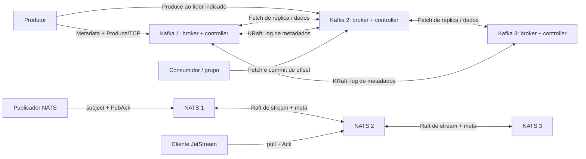

# Fundamentação científica e respostas às questões — M2, Tema 4, Ênfase D

**UNIVALI — Sistemas Distribuídos, prof. Ramices dos Santos Silva — 2º semestre de 2026**  
**Objeto:** Apache Kafka em KRaft × NATS JetStream. **Data de pesquisa/verificação:** 28 out. 2026.  
**Natureza do documento:** base científica e respostas Q1–Q14/S1–S4, **não** o relatório final de 15–25 páginas.  
**Base de código/evidências:** [`faae727be554574017b5856d486d73d5c2461bf7`](https://github.com/leodbc/Pub-Sub-Architecture/commit/faae727be554574017b5856d486d73d5c2461bf7), sobretudo [`docs/evidencias_experimentos.md`](evidencias_experimentos.md); [release imutável do ponto de vista desta fase](https://github.com/leodbc/Pub-Sub-Architecture/releases/tag/m2-fase1-evidencias-2026-10-28). O PDF normativo fornecido pela equipe, **“Roteiro Trabalho M2 Completo (todos os temas)”**, 42 páginas, prevalece sobre resumos. Texto literal das questões na Parte B/C, conforme pp. 8 e 33 do PDF; requisito R2/R5/R6, pp. 7–9; Tema 4 e Ênfase D, pp. 29–34.  
**Convenção epistêmica:** **[F]** fato sustentado por fonte primária; **[O]** observação instrumental registrada na Fase 1; **[I]** interpretação causal/conceitual sujeita às premissas indicadas; **[L]** limite de validade, ausência de medição ou contraexemplo. As referências numéricas `[R1]` etc. remetem à Parte E, **não** a resultados de testes.

## Parte A — Fundamentação científica

### A.1 Problema histórico, publicação/assinatura e origem

**[F]** Kafka foi apresentado por Jay Kreps, Neha Narkhede e Jun Rao no NetDB'11 como sistema distribuído para coleta e distribuição de grandes volumes de *logs* de atividade, desacoplando produtores de múltiplos sistemas de processamento, inclusive análise em lote e quase tempo real. A motivação de baixa latência, alta vazão e possibilidade de releitura deve ser entendida no contexto da LinkedIn de 2011, não como prova de desempenho da versão 4.4.0 atual [R1]. **[F]** Eugster, Felber, Guerraoui e Kermarrec sistematizam o publish-subscribe como desacoplamento no espaço, no tempo e na sincronização, distinguindo subscrição por tópico/assunto e por conteúdo [R2]. Kafka opera com tópicos particionados e persistência/replay; é mais que um canal volátil de notificações.

Uma aplicação de pedidos pode publicar `PedidoCriado(cliente1, 7)` sem saber se a cobrança e o estoque estão funcionando no mesmo instante. Cada aplicação mantém estado e posição independentes de consumo. Isso melhora elasticidade, mas introduz os desafios distribuídos de descoberta do líder, replicação, escolha de ordem, falha ambígua do produtor, tolerância à partição e retenção/limpeza do log. **Não** elimina a necessidade de idempotência de efeitos externos, esquema de eventos, controle de acesso, observabilidade ou supervisão operacional [R1–R4].

### A.2 Modelo de dados, clientes e camadas

**[F]** Um *topic* é dividido em partições. Cada partição armazena uma sequência anexável de *record batches* em segmentos de log, com offsets monotônicos **locais à partição** (não IDs universais, nem relógios). A chave, quando presente, influencia a seleção da partição segundo o particionador; estabilidade depende da mesma quantidade de partições/mesma política. Um registro tem chave opcional, valor, timestamp e cabeçalhos; a ordem é estabelecida pela posição no log da partição. Retenção temporal/por tamanho e compactação podem remover registros antigos; offset não significa que o payload será preservado para sempre. O consumidor pede dados por offset e pode reler mensagens ainda retidas. **[O]** E2 reproduziu 36 produções e 36 leituras, 12 chaves × 3 registros, três partições, correspondência de chave/partição/offset e nenhuma migração de chave, arquivo `e2_keys.log` [R1, R3, R4; EV-E2].

**[F]** Os produtores utilizam um conjunto `bootstrap.servers` para obter metadados do cluster, escolher a partição e localizar seu broker líder. Um nó bootstrap **não** é um diretório central permanente e não recebe obrigatoriamente todos os dados. O controlador KRaft é responsável pelo estado de metadados; cada broker serve partições; o coordenador de grupo é outro papel lógico, residente em broker. Produtores enviam pelo protocolo binário Kafka/TCP; consumidores fazem *fetch* (pull), gerenciam offsets e podem usar consumer groups [R3–R6].

### A.3 Topologia autoral e sequência lógica de E2

Este desenho representa a **arquitetura configurada em** [`kafka/docker-compose.yml`](../kafka/docker-compose.yml) e [`nats/docker-compose.yml`](../nats/docker-compose.yml); as setas de replicação são **mecanismos documentados**, não traces de cada pacote. Todas as instâncias do Kafka local acumulam papéis `broker,controller`; não se deve generalizar tal *colocation* como recomendação universal de produção.



```mermaid
sequenceDiagram
  autonumber
  participant P as Produtor
  participant B as Broker bootstrap
  participant L as Lider da particao
  participant F as Followers em ISR
  participant C as Consumidor
  P->>B: MetadataRequest(topic)
  B-->>P: Particoes e lideres atuais
  P->>L: Produce(chave, registro, acks=all)
  F->>L: Fetch de replicacao
  L-->>F: Registros do log
  F->>L: Fetch seguinte (avanco de posicao)
  Note over L,F: Avanco do high watermark condicionado ao ISR
  L-->>P: ProduceResponse quando condicoes de acks satisfeitas
  C->>L: Fetch(offset da particao)
  L-->>C: Registros visiveis sob HW/LSO conforme isolamento
  Note over P,C: Diagrama logico; E2 mediu apenas extremidades e metadados
```

**[L]** O `e2_keys.log` prova chaves, posições e leituras; **não** instrumenta todos os saltos internos nem o instante individual em cada follower. O líder exato varia por partição/instante; as setas a Kafka 2 ilustram uma possibilidade e não um líder fixo da execução [EV-E1, EV-E2].

### A.4 Replicação de dados Kafka: líder, ISR, high watermark e confirmação

**[F]** Cada partição tem um líder e réplicas seguidoras que **buscam** (*fetch*) entradas do líder. O *In-Sync Replica set* (ISR) contém réplicas consideradas suficientemente atualizadas pelo protocolo. O *high watermark* (HW) delimita a parte comprometida/visível do log com base na progressão das réplicas elegíveis; em leitura comum, consumidores não acessam um registro ainda acima dessa fronteira. Em leitura `read_committed`, transações exigem adicionalmente o *last stable offset* (LSO). Portanto, **HW e LSO não são sinônimos** [R3, R4].

* `replication.factor=3` atribui três cópias da partição. `min.insync.replicas=2` impõe um tamanho mínimo de ISR para aceitar com sucesso uma escrita `acks=all`; não transforma a replicação de dados em eleição Raft por maioria.
* `acks=0`: produtor não espera resposta. `acks=1`: líder responde sem esperar todas as réplicas sincronizadas; perder o líder prematuramente pode perder mensagem já reconhecida. `acks=all`: confirmação depende de replicação no ISR atual **e** do mínimo configurado, não simplesmente de 2 entre 3 réplicas estáticas. Um ISR de três pode exigir as três para aquele ACK mesmo com `min.insync.replicas=2` [R3, R5].
* `unclean.leader.election.enable=false` evita eleger réplica sabidamente não sincronizada como recurso automático de último caso, aceitando indisponibilidade para evitar retrocesso de dados confirmados nas condições modeladas. Falhas de armazenamento correlacionadas, configurações perigosas, perda de todas as cópias e outras premissas não são cobertas por afirmações absolutas [R3, R5].
* No Kafka moderno existe também **ELR** (*Eligible Leader Replicas*, KIP-966), observado como campo `Elr`. Segundo a documentação oficial Kafka 4.4, ELR é **habilitado por padrão em clusters novos a partir do Kafka 4.1**; isso altera possibilidades de eleição e a interpretação operacional de `min.insync.replicas` quando o ISR se reduz. A presença do campo `Elr`, a versão 4.4 ou o padrão documentado não demonstram, **por si só**, que a estratégia efetivamente atuou em determinada falha deste laboratório: a configuração efetiva e as transições de elegibilidade **não foram instrumentadas**. Portanto não presumir nem ISR clássico universal, nem eleição ELR ocorrida sem logs específicos [R9, R10, R21].

**[O]** E3 aferiu tempos de **ACK** e de **callback de consumidor** separadamente; nunca o tempo de aplicação em cada follower. Benchmark histórico (n=5, média ± DP amostral): Kafka `acks=all` **0,764 ± 0,058 ms**, **1.310,4 ± 97,2 msg/s**; Kafka `acks=1` **0,338 ± 0,036 ms**, **2.944,0 ± 282,7 msg/s**; NATS RF3 **0,558 ± 0,008 ms**, **1.778,4 ± 25,2 msg/s**. Experimento complementar de 5 ciclos, com instrumento/carga distintos: `acks=all` ACK **0,818 ± 0,032 ms**, visibilidade **0,792 ± 0,028 ms**; `acks=1` ACK **0,329 ± 0,056 ms**, visibilidade **0,844 ± 0,066 ms**; NATS ACK **0,532 ± 0,043 ms**, visibilidade **0,570 ± 0,046 ms**. O callback pode anteceder o retorno ao produtor. **[L]** Não agregar essas séries, nem inferir visibilidade == instante de replicação [EV-E3].

### A.5 KRaft: consenso de metadados, não consenso por partição de dados

**[F]** KIP-500 propõe retirar ZooKeeper do plano de controle e persistir mudanças (tópicos, partições, ISR, configurações, liderança, registros de brokers) em um **log de metadados**. KIP-595 define protocolo da família Raft, com eleições por votação/época e replicação *pull-based* do log de metadados, sendo esta última nuance distinta da implementação didática clássica de `AppendEntries`. Com **três votantes**, a maioria é **2**; tolera **uma** parada de votante para continuar decisões, desde que conectividade/tempo e condições operacionais sejam suficientes. O *active controller* decide mudanças de metadados e atribui liderança de partições, mas **não** é o mesmo papel que o líder de cada partição de dados [R7, R8, R11].

A época de liderança de uma **partição** protege a sucessão das lideranças daquele log (inclusive *fencing* e reconciliação por época/offset), enquanto a época do **controlador** identifica liderança do metagrupo. Não têm o mesmo contador ou incrementam sempre juntos. **[O]** E8 normativo observou líder da partição 0 `2→3`, `partition leader epoch 0→1`, controlador `LeaderEpoch 1→1`; eleições históricas do controlador foram observadas separadamente em cinco rodadas. **[L]** A divergência de épocas não é defeito; prova que os domínios de coordenação são distintos [EV-E8].

Quando somente um controlador dos três está acessível, não há maioria Raft para confirmar **nova alteração de metadados**. **[O]** E5: com apenas `kafka3` ativo, uma solicitação `CreateTopics` terminou por timeout externo em aproximadamente **32,028 s**; o tópico apareceu **após** restaurar os outros nós. **[L]** Não foi registrado o instante da criação: uma operação pendente pode ter se completado após a restauração; não há prova de criação em ausência de quórum nem de perda de dados [EV-E5]. A disponibilidade de **dados de partições já existentes** é problema diferente da disponibilidade de mudança de metadados; a colocalização broker/controlador do laboratório acrescenta acoplamento entre falhas.

### A.6 Consumidores, posições, grupos e semânticas de processamento

**[F]** Em grupos Kafka, consumidores com o mesmo `group.id` repartem partições atribuídas; consumidores de grupos **diferentes** observam fluxos independentemente. A posição em memória (`position`) difere do *committed offset* persistido do grupo, que normalmente indica **o próximo registro a ler**, não o último processado. No rebalanceamento participam o coordenador de grupo (broker responsável, ligado ao particionamento do tópico interno `__consumer_offsets`), os membros e o protocolo/assignor. Protocolo clássico e protocolo de grupo mais recente diferem na atribuição; **não** é o controlador KRaft que distribui diretamente cada partição aos consumidores [R3, R12].

**[O]** E7 normativo: consumidor 1 processou offsets `0,1`, confirmou o próximo offset `2` (`CURRENT-OFFSET=2`), saiu sem `LeaveGroup`; novo processo **do mesmo grupo** leu `2,3,4,5`, sem reler `0,1` naquela sequência. Arquivos `e7_first_interrupted.log`, `e7_offset_after_crash.log`, `e7_resumed.log`, `e7_assertions.json`. **[L]** Isso não estabelece exatamente-uma-vez genérico em caso de crash entre efeitos externos e commit, nem explica o tempo de catch-up do ISR [EV-E7].

**[F]** Semânticas básicas são de **processamento ponta a ponta**, não só de `acks`: (i) *at-most-once*, commit antes do efeito/processamento, potencial perda; (ii) *at-least-once*, efeito antes do commit, com potencial repetição; (iii) *exactly-once* **condicional e dentro do escopo** de transações Kafka, produção idempotente, isolamento `read_committed`, commit atômico de resultados/offsets ou mecanismos equivalentes da aplicação. Não equivale a efeito externo exatamente uma vez em banco/HTTP sem transação integrada ou deduplicação. Retries podem reproduzir escritas ambíguas; produtor idempotente reduz duplicações de retry em seu escopo, mas não significa que toda operação de negócio seja idempotente [R3, R6].

### A.7 NATS Core versus NATS JetStream

**[F]** *Core NATS* encaminha eventos por *subjects* com grupos de assinantes tipo fila (*queue groups*), sem persistência automática; por padrão, entrega no máximo uma vez para assinantes conectados. **JetStream** acrescenta *streams* persistentes, associados a padrões de subjects, sequências do stream e *consumers* stateful (duráveis ou efêmeros; pull ou push), políticas de retenção e ACKs do consumidor [R13, R14]. Um `PubAck` de persistência do JetStream **não** é a mesma confirmação que um ACK de consumo (`Ack`, `AckSync`). NATS oferece deduplicação de publicação por `Nats-Msg-Id` dentro de janela configurada e confirmação de processamento de ACK pelo servidor; isso não implica execução externa exatamente-uma-vez ilimitada [R13, R14].

**[F]** Em cluster JetStream há um **meta group** Raft (colocação/configuração de streams e consumers), grupos Raft separados para dados de streams replicados e coordenação de estado de consumidores conforme a configuração; a unidade de replicação do ensaio RF3 é o stream, não uma partição Kafka. Um stream RF3 usa maioria 2/3 para comprometer alterações, suportando uma falha de nó se permanecem dois membros comunicantes; dois nós indisponíveis inviabilizam confirmações majoritárias. A leitura e a entrega dependem também do líder e do estado de consumidores; não se deve presumir que todo tipo de leitura, em toda falha, obedeça a uma matriz binária universal [R14, R15]. **[O]** E8 histórico identificou mudança de líder do **meta group** NATS, porém **não** mediu seu termo/época Raft; nunca substituí-lo por zero ou por `leaderEpoch` Kafka [EV-E8].

### A.8 Segurança, recuperação, alcance dos resultados

**[F]** Falhas consideradas nas garantias usuais são principalmente parada, perda de conectividade, atraso e omissão, com relógios e redes de comportamento parcialmente síncrono para progresso de eleições; Raft não resolve tolerância a nós bizantinos. Quóruns preservam segurança sob hipóteses de não-Byzantine e armazenamento íntegro, enquanto progresso depende de maioria alcançável e temporização. Kafka pode reconstruir follower lendo offsets faltantes, e KRaft utiliza log/snapshots de metadados. JetStream recupera streams replicados por sincronização Raft e tem mecanismos específicos de snapshot/backup; backup não substitui desenho consistente do ciclo de vida. O algoritmo Chandy–Lamport é procedimento de captura de **estado global consistente com mensagens em trânsito**, não o mesmo que snapshot de compactação de um log Raft [R11, R15, R16].

**[O]** E7 histórico: tempo de restart até estado de três réplicas saudáveis, Kafka **3.549,9 ± 1.551,5 ms**, NATS **2.494,5 ± 1.185,9 ms** (n=5 por sistema; dados do runner). **[L]** São tempos do procedimento e da sondagem, não duração interna de eleição/consenso, e `catch-up` de réplica não se confunde com retomada de offset de consumidor [EV-E7]. Laboratório Docker em um único host compartilha máquina, discos/rede física, kernel e relógio; não reproduz independência de domínios de falha, disco, WAN ou falhas bizantinas. O laboratório usa `PLAINTEXT` e ausência de autenticação: **não é configuração de produção**; exigir TLS, SASL/mTLS, ACL/autorizações, segredos, quotas, isolamento, hardening, auditoria e backups [R4, R17].

## Parte B — Questões norteadoras comuns Q1–Q14 (transcrição normativa integral)

### Q1. Que problema de sistemas distribuídos o sistema resolve? Quais transparências ele oferece ao usuário (acesso, localização, replicação, falha, concorrência)?

**Resposta.** **[F]** Kafka distribui registros de eventos duráveis e reprocessáveis entre produtores e consumidores sem acoplamento direto, e enfrenta escala de vazão, replicação, recuperação e concorrência [R1–R3]. **Transparência de acesso**: APIs de publicação/consulta ocultam formatos internos de segmentos, mas exigem offsets/tópicos/partições explicitamente. **Localização**: clientes usam bootstrap e metadados para redescobrir líderes; IP/advertised listener precisa estar correto. **Replicação**: produtor interage com líder lógico e geralmente não escolhe follower; ISR afeta garantia e disponibilidade. **Falha**: retries/failover escondem parte das falhas, porém timeouts, rebalanceamentos, registros não comprometidos e erros são visíveis. **Concorrência**: múltiplos produtores/consumidores atuam, mas não existe serialização global entre partições; ordem por partição e consumo por grupo têm limites. **[O]** E1 prova três nós; E2 prova redescoberta lógica/atribuição de posições apenas nas interfaces instrumentadas; E5/E6 mostram que falha **não** é transparente em todas as operações. **[L]** Essas transparências são **parciais**, não promessas universais [EV-E1, EV-E2, EV-E5, EV-E6].

### Q2. Qual é a arquitetura? Identifique estilo arquitetural (cliente-servidor, P2P, em camadas, centrado em dados, orientado a eventos), componentes e papéis. Apresente um diagrama próprio.

**Resposta.** **[F]** Externamente Kafka combina **cliente-servidor** (TCP producer/broker/consumer), **centrado em dados** (log de partições) e **orientado a eventos** (pub/sub), com camadas de acesso a dados, replicação e metadados. Internamente há comunicação ponto a ponto de brokers e controladores, sem ser um DHT/P2P aberto. Papéis: producer, leader/follower de partição, active/follower controller KRaft, consumer, group coordinator; no NATS, servidores roteadores, meta leader, stream leader, stream followers e consumers duráveis. O **diagrama autoral A.3** representa explicitamente os três brokers/controllers Kafka e o grupo NATS RF3. **[O]** E1: `e1_kafka_topic.log`, `e1_kafka_quorum.log`, `e1_nats_stream.log`; configs de Compose declaram papel e endereços. **[L]** Diagrama é representação de topologia e protocolo, não captura de pacotes [R3, R7, R14; EV-E1].

### Q3. Como um cliente localiza um dado ou serviço? A resolução é hierárquica, por consulta a um diretório central, ou calculada (hash, ...)?

**Resposta.** **[F]** O cliente Kafka conhece inicialmente um ou mais endereços bootstrap; a resposta *Metadata* revela brokers, tópicos, partições e líderes. A escolha de partição por chave usa política/particionador (frequentemente hash), não uma DHT global; a localização física do líder é **consultada nos metadados** (dinâmicos). O coordenador de grupo é escolhido a partir da partição de `__consumer_offsets` correspondente ao grupo; a localização também é obtida via protocolo. No NATS há subjects roteados pelos servidores; a alocação de streams é gerida pelo meta group, em contraste com hashing de partição Kafka. **[O]** E2 `e2_keys.log`: 12 chaves estáveis na mesma partição nas condições fixadas. **[L]** Não se provou resharding, troca de particionador nem continuidade dessa associação depois de mudar a contagem de partições [R3, R14; EV-E2].

### Q4. Como os nós se comunicam? Protocolo, síncrono ou assíncrono, direto ou indireto, serialização e semântica de entrega (no máximo uma, ao menos uma, exatamente uma).

**Resposta.** **[F]** Kafka oferece protocolo próprio de requests/responses binários sobre TCP, com serialização de batches (chave/valor e demais atributos); `Produce`, `Fetch`, `Metadata`, `OffsetCommit`, heartbeats e chamadas administrativas. Produtor emite assíncronamente com callback/future, ou aguarda a resposta no código cliente; follower faz *fetch* ao líder, e consumidor faz *pull*: há comunicação direta cliente-broker para transporte, **indireta** entre aplicativos por log persistente. NATS Core usa protocolo por subjects e NATS JetStream agrega APIs e ACKs de publicação/consumo. **[F]** At-most/at-least/exactly-once descrevem **efeito de processamento e entrega em escopo definido**; ACK de rede/servidor não equivale a efeito da aplicação. Kafka requer idempotência e transações para as condições de exactly-once, não configuração isolada de `acks=all` [R3, R4, R6, R13]. **[O]** E2 `e2_keys.log`, E3 `kafka_all.csv`/`kafka_1.csv`/`nats.csv`; E7 `e7_resumed.log`. **[L]** Não houve trace de cada salto nem experimento geral de efeitos externos exatamente uma vez [EV-E2, EV-E3, EV-E7].

### Q5. Qual é o modelo de replicação? Primário-backup, multilíder, sem líder (quórum) ou máquina de estados replicada? Quantas réplicas e quem aceita escritas?

**Resposta.** **[F]** Para **dados Kafka**, cada partição aplica líder/seguidores (*primary-backup*, single-leader), três cópias configuradas (RF3), followers buscando registros; o líder aceita `Produce`, podendo haver encaminhamento/erro até descobrir o atual. O ISR/HW gerencia commit/elegibilidade, **não** um grupo Raft majoritário por partição. Para **metadados Kafka**, três controladores formam log de máquina de estados replicada por KRaft/Raft, um controlador ativo aplica decisões com maioria de votantes. Para **dados NATS JetStream**, stream RF3 replica com Raft por grupo de stream, líder aceita/grava e confirma quando o grupo compromete. **[O]** E1 logs `e1_kafka_topic.log`, `e1_kafka_quorum.log`, `e1_nats_stream.log`; E3 benchmark `e3_kafka_acks_all.log`/`e3_nats_rf3.log`. **[L]** “O Kafka usa Raft para todas as partições” é incorreto [R3, R7, R8, R14; EV-E1, EV-E3].

### Q6. Qual modelo de consistência o sistema oferece (linearizável, sequencial, causal, eventual, leitura das próprias escritas)? Demonstre com experimento.

**Resposta.** **[F]** A noção pertinente ao Kafka é um **log ordenado por partição**, com fronteira de registros confirmados HW, e *read_committed* respeitando adicionalmente LSO transacional. Se cliente lê o mesmo log comprometido em ordem, há ordem consistente de offsets; **isso, isoladamente, não constitui prova formal de linearizabilidade de operações concorrentes** nem ordem global entre partições. Atributos de causalidade entre partições não são assegurados automaticamente. Leitura das próprias escritas pode ocorrer depois de ACK de escrita comprometida com leitura da partição apropriada e visibilidade compatível; configuração/isolation e erros importam. NATS stream mantém sequência própria de registros comprometidos, mas sem teste de história concorrente linearizável. **[O]** E4 `e4_kafka_multi_verify.log`: **zero inversões por partição** e **71 inversões na concatenação global** (90 chaves/3 partições); E2 `e2_keys.log` mostra offsets iguais. E3 mediu callback e ACK; não comprovou ordem temporal de linearização. **[L]** Sem teste de concorrência e história com tempos de invocação/resposta, não atribuir linearizabilidade, causalidade global ou consistência eventual como garantias demonstradas. **[I]** O sistema favorece consistência do prefixo comprometido da partição, sujeito às condições de ISR e eleição [R3, R4, R18; EV-E2, EV-E3, EV-E4].

### Q7. O sistema usa quórum? Quais são N, R e W (ou a maioria exigida)? Vale R + W > N? Quantas falhas f ele tolera com quantos nós? Demonstre perdendo o quórum.

**Resposta.** **[F]** Para controladores KRaft e stream Raft RF3 NATS, `N=3`, maioria `⌊N/2⌋+1=2`, tolerância `f=1` falha para progresso sob hipóteses usuais. Raft usa **quóruns majoritários intersectantes de eleições/commit**; não é apropriado atribuir arbitrariamente `R=2, W=2` a APIs de leitura Kafka/NATS: quóruns de votação/replicação não são automaticamente o modelo Dynamo de leituras/escritas `R+W>N`. Numa abstração de quorum clássico com `N=3`, `R=2,W=2` satisfaz `R+W>N`, mas **não** descreve necessariamente as operações desses produtos. Kafka **dados**: ISR variável, RF3, `min.insync.replicas=2` e `acks=all` exige ISR suficiente e confirmação das réplicas sincronizadas; `acks=1` não opera via quorum de maioria. **[O]** E5 `e5_5x_matrix.csv`: Kafka `acks=all` confirmou 5/5 com 3 ou 2 nós; com um nó, timeout 5/5. Kafka `acks=1` com um nó: confirmou **2/5**, timeout **3/5**; não exigir disponibilidade permanente. NATS PubAck 5/5 com 3 ou 2; 0/5 confirmações com 1. E5 `e5_create_without_quorum.log`: sem maioria de controladores, CreateTopics não confirmou, embora o tópico aparecesse após restauração. **[L]** Timeouts não demonstram perdas e uma configuração RF3/ISR não determina isoladamente o resultado de todo endpoint [R3, R7, R11, R14; EV-E5].

### Q8. Existe líder, primário ou coordenador? Como é escolhido (estático, Raft, Paxos, ZAB, controlador)? Compare com Bully e Anel.

**Resposta.** **[F]** Há três eleições conceitualmente distintas: controlador ativo Kafka é eleito via votos do quórum KRaft/Raft; líderes de partições são selecionados/coordenados pelo plano de controle Kafka, normalmente dentre réplicas elegíveis (ISR e regras atuais/ELR), não por votação Raft independente entre três cópias da partição; NATS meta leader e stream leader são escolhidos pelos respectivos grupos Raft. O coordenador de consumer group é um broker com responsabilidade pela partição interna do grupo, não líder eleito pelos consumidores via Bully/Anel. **Bully** e **Anel** escolhem um coordenador com base em IDs/comunicação, mas, por si, **não** fornecem consenso sobre log, compromisso majoritário, fencing e recuperação de histórico; Raft relaciona eleição, termos e integridade do log. **[O]** E8 histórico `e8_metagrupo.md` e `e8_nats_r*_elected.txt`: trocas de líderes; E8 normativo `e8_epoch_comparison.json`: época da partição muda, controlador constante. **[L]** Não houve observação direta do termo Raft interno NATS [R7, R8, R11; EV-E8].

### Q9. Como o sistema ordena eventos ou versões (número serial, época, termo, offset, revisão, carimbo de tempo)? Relacione com relógios de Lamport e vetoriais e com multicast ordenado.

**Resposta.** **[F]** Offset representa ordem **total local a uma partição**; log end offset, high watermark, épocas de liderança e metadados compõem outros domínios. Em KRaft, época/termo ordena mandatos do controlador e índice/offset ordena seu log. A época de uma partição identifica sucessão de líderes daquela partição. No JetStream, stream sequence ordena o stream e termos Raft ordenam eleições internas. **Relógio de Lamport** captura a relação *happens-before* em uma ordem lógica que pode ser estendida a uma ordem total arbitrária com desempate; **vetoriais** permitem distinguir causalidade de concorrência, não sendo um campo nativo inferível dos offsets Kafka. *Multicast totalmente ordenado* exigiria que todas as entregas relevantes concordassem sobre a mesma ordem global; Kafka **não** oferece tal ordem entre partições, embora possa ordenar dentro de uma única partição. **[O]** E4 0 inversões locais/71 globais; E8 época de partição `0→1` e de controlador `1→1`. **[L]** Timestamp wall-clock do registro pode refletir produtor/append e não prova causalidade nem relógios independentes [R3, R11, R18; EV-E4, EV-E8].

### Q10. Qual modelo de falhas é assumido (parada, omissão, bizantina)? Como as falhas são detectadas (heartbeats, timeouts)? O que acontece com a falha de 1 nó e com a falha da maioria?

**Resposta.** **[F]** As garantias usuais do Kafka/JetStream cobrem falha por parada, falha de rede/omissão e atraso em modelo parcialmente síncrono para progresso de eleições. Controladores Kafka monitoram brokers por heartbeats; Raft identifica indisponibilidade de líder via timeout de eleição/heartbeats e de seguidores via replicação; grupos de consumidores usam heartbeats/leases de sessão; ISR responde à falta de progresso da réplica. Detectores baseados em tempo podem suspeitar de nó lento sem comprovar parada. **Não** são protocolos de consenso tolerantes a servidores bizantinos. Com um nó parado, dois votantes Raft e (nas condições configuradas) cópias suficientes de dados permitem progresso; com dois, falta maioria, metadados novos e streams RF3 ficam indisponíveis para confirmação. Kafka `acks=1` pode **às vezes** responder sem min ISR, mas não há garantia global de disponibilidade quando se perdeu também coordenação. **[O]** E5 matriz das cinco repetições e E6 `e6_operations.csv`/`e6_clocks.csv`; **[L]** falhas de energia, corrupção de disco e adversários maliciosos não foram ensaiados [R3, R7, R11, R14; EV-E5, EV-E6].

### Q11. Diante de uma partição de rede, o sistema prioriza consistência ou disponibilidade? Sustente com o experimento E6 (pesquise o teorema CAP e a extensão PACELC).

**Resposta.** **[F]** Sob partição, *consistência* em CAP significa tipicamente propriedade próxima de **linearizabilidade de um objeto abstrato**, e *disponibilidade* significa **toda requisição de nó não falho terminar com resposta apropriada**, não apenas 'a maioria operou'. Gilbert e Lynch formalizam a impossibilidade de assegurar simultaneamente ambas sob particionamento arbitrário [R19]. PACELC separa **P**: escolha disponibilidade/consistência durante partição, e **EL**: troca entre latência e consistência sem partição [R20]. **[I]** Kafka `acks=all` com `min ISR=2`, KRaft maioria e JetStream RF3 privilegiam confirmação consistente sob hipóteses do protocolo e podem sacrificar disponibilidade na **minoria**. Não faz sentido rotular o **sistema inteiro** como simplesmente CP para todas as operações e configurações: `acks=1`, dados existentes, descoberta de líder, leitura, retenção e disponibilidade de metadados têm condições distintas.

**[O]** E6 isolou fisicamente um cliente minoritário em bridge Docker interna exclusiva e o cliente majoritário na rede original. Kafka, cinco rodadas: escrita confirmada na maioria 5/5, registro anterior visível lá e 0 confirmações `acks=all` na minoria; NATS, 5 rodadas: maioria teve ACK eventual e registro anterior; minoria 0/5 confirmações e 0/5 leituras confirmadas no intervalo. Kafka E6: duração da partição **24.042,522 ± 2.156,533 ms**, tempo da desconexão ao primeiro ACK da maioria **12.842,075 ± 2.222,348 ms**, saúde após reconectar **3.581,137 ± 2.444,622 ms**. NATS: **29.982,551 ± 18.641,682 ms**, **6.107,930 ± 1.167,910 ms**, **3.856,727 ± 1.785,055 ms**. **[L]** Séries em runners/datas diferentes, com ações de Docker, sondagem, reconexão e retentativas: **não são tempos internos de consenso**; a ausência de leitura na minoria na janela não prova perda de mensagens ou impossibilidade universal de qualquer leitura. E6 não é prova matemática do CAP, mas é observação compatível com previsões específicas [EV-E6].

### Q12. Como um nó que volta (ou um nó novo) recupera o estado? Log, snapshot, transferência completa ou incremental? Relacione com estado global e snapshots.

**Resposta.** **[F]** Um follower Kafka reentra e compara posições/épocas, obtendo registros faltantes do líder; se havia divergência, precisa conciliar o log com a liderança válida e o high watermark. A sincronização é tipicamente incremental quando o histórico necessário ainda existe; mecanismos de retenção e recomposição podem exigir recuperação maior. KRaft faz replay do log de metadados e snapshots quando apropriado. JetStream usa reconciliação do log Raft e mecanismos de snapshot/backup com semântica própria. **Não** há identidade automática entre 'o arquivo existe no nó' e 'ambas as réplicas têm o mesmo prefixo confirmado'. **Chandy–Lamport** obtém snapshot distribuído de cortes locais e mensagens em trânsito para detectar estado global consistente; snapshot Kafka de compactação/checkpoint é outra finalidade e não constitui automaticamente um corte distribuído Chandy–Lamport. **[O]** E7 `medicoes_falhas.csv`, logs de ISR/stream e `verify`: Kafka **3.549,9 ± 1.551,5 ms**, NATS **2.494,5 ± 1.185,9 ms** para recuperar estado saudável (n=5); complemento `e7_resumed.log` mostra retomada de **consumidor**, que é propriedade diferente da recuperação de réplica. **[L]** Não houve captura atômica do estado global nem prova bit a bit de todos os segmentos [R3, R11, R15, R16; EV-E7].

### Q13. Quais problemas clássicos aparecem no sistema (eleição, exclusão mútua, consenso, multicast ordenado, generais bizantinos) e como ele os resolve ou os evita?

**Resposta.** **[F]** **Eleição**: controlador KRaft e líderes Raft JetStream usam épocas/votos; líderes de partições Kafka são atribuídos pelo controlador com elegibilidade e fencing. **Consenso**: presente no metagrupo Kafka e nos grupos Raft JetStream, não é equivalente a replicação ISR de dados. **Exclusão mútua**: líder único por partição/termo é uma forma de serialização de append e fencing; não se trata de serviço geral de mutex distribuído para aplicações. **Multicast ordenado**: eventos da mesma partição/stream têm ordem acordada no seu escopo; não há multicast global por Kafka multilpartição. **Generais bizantinos**: arquitetura convencional não oferece tolerância BFT; autenticidade e integridade dependem de controles externos. Na impossibilidade FLP, consenso determinístico não garante término num ambiente totalmente assíncrono com falhas por parada; por isso timeouts e sincronia eventual afetam *liveness*, preservando segurança sob hipóteses apropriadas. **[O]** E4 comprova escopo local da ordem; E5/E6 demonstram redução de disponibilidade; E8 observa eleições/épocas. **[L]** Nenhum teste de nó malicioso ou demonstração formal de safety/liveness foi executado [R3, R7, R11, R18, R19; EV-E4, EV-E5, EV-E6, EV-E8].

### Q14. Onde o sistema é usado na prática, quais são suas limitações e que cuidados de segurança exige?

**Resposta.** **[F]** O caso originário documentado foi o pipeline de logs de grande volume da LinkedIn [R1]. Usos típicos incluem *event streaming*, auditoria e CDC, processamento assíncrono, integração de microsserviços e analytics; JetStream atende distribuição por subjects, retenção e workloads que precisam de consumidores duráveis [R3, R13]. **Limitações:** compromisso entre número de partições e ordem, custos de retenção/disco, latência de `acks=all`, impacto de ISR pequeno, throughput condicionado a batch/carga/recursos, coordenação de consumer groups, transações Kafka limitadas em escopo e ausência de exactly-once automático para banco externo. **Segurança:** TLS entre clientes/brokers/controladores, autenticação SASL/mTLS conforme produto, ACLs por tópicos/grupos, credenciais NATS e *accounts*/permissions, mínima exposição de listeners/monitoramento, segregação de redes, gestão de segredos, audit logs, quotas, patches, backups/restore e testes periódicos. **[O]** `kafka/docker-compose.yml` mostra `PLAINTEXT`, e `nats/docker-compose.yml` não configura autenticação; não publicar esse Compose para a internet. E3 revela latência/vazão *local*, E5/E6 as falhas, E7 recuperação. **[L]** Sem auditoria de segurança, carga em nuvem, hardware independente ou teste de produção, os resultados não atestam SLA real nem segurança operacional [R1, R3, R13, R17; EV-E3, EV-E5, EV-E6, EV-E7].

## Parte C — Questões específicas do Tema 4, S1–S4 (transcrição normativa integral)

### S1. Por que se diz que um log replicado é uma forma de máquina de estados replicada? Por que o Kafka garante ordem total apenas dentro de uma partição? Relacione com o sequenciador do Trabalho 1.

**Resposta.** **[F]** Uma *máquina de estados replicada* (SMR) pressupõe que réplicas partem de estado equivalente e **aplicam os mesmos comandos em ordem comum, determinística**, de modo a obter estados equivalentes. O *log replicado* é o mecanismo que pode fornecer a ordem comum; **um arquivo replicado por si só não é automaticamente uma SMR**, pois é preciso definir interpretação/aplicação, atomicidade, estado inicial e recuperação [R11]. KRaft usa log de **metadados** para sustentar estado replicado dos controladores. Para dados Kafka, réplicas de **uma partição** mantêm prefixo de registros sob regras de líder, ISR e high watermark, e um consumidor ordena a leitura pelo offset; isso não é idêntico a cada aplicação de consumidor processar deterministicamente o mesmo comando.

**Exemplo:** se o tópico `pedidos` tem partições 0,1,2, as posições `(0,7)` e `(1,7)` são incomparáveis como ordem global. Chaves constantes tendem à mesma partição na configuração fixa, mantendo FIFO daquele fluxo enquanto pressupostos de produtor/retries são respeitados. Um **sequenciador global** do Trabalho 1 ordenaria todos os eventos por número único antes de disseminar, impondo um ponto de serialização; Kafka obtém paralelismo ao evitar tal sequenciador global. Uma única partição ou sequenciador externo daria ordem total **nesse escopo**, com custo de paralelismo/gargalo e sem resolver magicamente causalidade de efeitos externos. **[O]** E4 `e4_kafka_multi_verify.log`: 0 inversões por partição e 71 na leitura concatenada; E2 `e2_keys.log`: 36 registros roteados por chave. **[L]** Não possuímos código/artefato original do Trabalho 1 nesta evidência; a comparação refere-se ao **modelo de sequenciador mencionado pelo PDF**, não a uma análise validada daquela implementação particular [R1, R3, R11, R18; EV-E2, EV-E4].

### S2. Compare as semânticas de entrega do Kafka (no máximo uma, ao menos uma, exatamente uma) com as semânticas de invocação remota vistas na Unidade 3 (talvez, ao menos uma, no máximo uma).

**Resposta.** **[F]** Em RPC, **talvez (*maybe*)** significa que uma chamada pode ou não executar sem garantia de resultado diante de falha (sem retry adequado); **ao menos uma** usa retries, podendo executar efeito mais de uma vez; **no máximo uma** depende de identificação/deduplicação e pode deixar a operação sem execução, mas nunca repeti-la na janela/escopo garantido. Essas são semânticas de **invocação/execução remota**; não equivalem literalmente às de **entrega/consumo** de um log. Em Kafka, **at-most-once** pode ocorrer com commit de offset antes do processamento (perda pós-crash); **at-least-once** com processamento antes do commit (reprocessamento pós-crash); **exactly-once** depende de produtor idempotente/transações e *offset commits* atômicos com saída Kafka, consumidores `read_committed` e condições documentadas; não há transação automática de efeitos remotos. A resposta RPC pode perder-se embora a execução tenha ocorrido; analogamente, timeout de `Produce` pode ocultar registro gravado (resultado **ambíguo**), justificando deduplicação e consulta do estado em vez de declarar perda. A idempotência do produtor evita certas duplicações no log, mas não impede duas chamadas semanticamente iguais emitidas intencionalmente nem a duplicação de efeito em API externa [R3, R6].

| Situação | Possível resultado | Medida de mitigação |
|---|---|---|
| RPC talvez / Kafka sem espera confiável | chamada ou publicação sem resultado inequívoco | consulta/reconciliação e identificador de operação |
| RPC ao menos uma / Kafka commit depois de processar | execução ou entrega repetida | função/consumidor idempotente e deduplicação |
| RPC no máximo uma / Kafka commit antes de processar | ausência de execução ou perda de processamento | aceitar perda ou reprojetar confirmação |
| Kafka exactly-once **no escopo transacional** | saída Kafka e offset confirmados atomicamente | idempotência, transação, isolamento apropriado |

**[O]** E7 commit `2` e retomada `2–5` prova apenas a sequência ensaiada; E3 distingue ACK e callback. **[L]** E1–E9 não testaram ponta a ponta uma transação entre Kafka e banco externo; não se reivindica tal garantia [EV-E3, EV-E7].

### S3. Compare o modelo ISR (tolera f falhas com f + 1 réplicas) com o quórum majoritário do Raft (2f + 1). Qual o papel do min.insync.replicas nessa conta?

**Resposta.** **[F]** A expressão didática “ISR tolera `f` falhas com `f+1` réplicas” diz respeito a **existir ao menos uma cópia elegível sobrevivente de entradas comprometidas**, se elas foram replicadas ao ISR requerido, não se perdeu armazenamento e não se escolheu líder sujo. **Não é uma fórmula de disponibilidade de novas escritas `acks=all`**: para continuar confirmando, a cardinalidade atual do ISR tem de ser pelo menos `min.insync.replicas`, e o líder deve contar com progresso das réplicas do ISR. Assim, se RF3, ISR inicial `{1,2,3}`, `minISR=2`: uma falha deixa dois ISR em condições típicas e acks=all pode progredir; duas falhas deixam um, e acks=all deixa de confirmar. Com minISR=3, **até uma** falha já pode impedir novos ACKs `all`. Com minISR=1, escrita pode continuar com cópia única e maior exposição à perda. `acks=1` **não** exige o mesmo compromisso do ISR nem quórum de maioria e pode confirmar localmente, mas lideranças/metadados e conexões podem impedir progresso.

**Raft** em configuração estável com `N=2f+1` votantes, por sua vez, exige interseção de **maiorias** para eleger/comprometer alterações; em `N=3`, `f=1`. KRaft aplica isso ao **metalog**, não à replicação de cada partição Kafka. NATS JetStream RF3 aplica maioria ao **grupo Raft do stream**. **Contraexemplo à equivalência:** se Kafka reduz ISR de 3 para 2, `acks=all` requer ambas as 2 **que pertencem ao ISR**, mesmo que o terceiro votante do KRaft esteja ativo; Raft do metagrupo pode prosseguir enquanto a partição não aceita novas escritas, e vice-versa quando há alterações de metadados pendentes. Com Kafka 4.4 há ainda elegibilidade ELR condicionada à configuração (KIP-966); não substituir regras operacionais verificadas por uma máxima sem qualificadores [R3, R5, R7–R10]. **[O]** E5 `e5_5x_matrix.csv`: Kafka acks=all 5/5 com dois nós, timeout 5/5 com um; acks=1 só 2/5 com um; NATS RF3 5/5 com dois e timeout 5/5 com um. E5 `e5_create_classification.json` e `e5_late_materialization.json` tornam **indeterminada** a data/instante da criação pós-timeout. **[L]** Não houve prova de todos os padrões possíveis de degradação de ISR/ELR [EV-E5].

### S4. Como o Kafka unifica os modelos publish-subscribe e fila de mensagens por meio de grupos de consumidores? Quem coordena o rebalanceamento?

**Resposta.** **[F]** Se `pedidos` tem 3 partições, um grupo `estoque` com 3 consumidores pode receber uma partição por consumidor; um quarto consumidor do **mesmo** grupo pode ficar ocioso (salvo mecanismos distintos de compartilhamento), porque a unidade de atribuição é a partição. Outro grupo `faturamento` lê **os mesmos registros** de forma independente (pub/sub). Dentro de cada grupo, há **divisão de trabalho parecida com fila**: cada partição pertence a um membro do grupo por vez no protocolo de atribuição; redelivery e reprocessamento ainda podem ocorrer, não se trata de fila destrutiva universal. O broker **coordenador de grupo** mantém estado/commits e gerencia o protocolo com membros. No protocolo **clássico**, um membro líder efetua a atribuição conforme assignor; no protocolo de rebalanceamento **mais recente**, o coordenador e atribuição do lado do servidor participam diretamente, sendo necessário não fundir esses mecanismos. Heartbeats, tempo de sessão, revogações e geração/época governam rebalanceamento. O **controlador KRaft** não é o *group coordinator* dos consumidores [R3, R12].

**[O]** E7 normativo, `e7_first_interrupted.log`/`e7_offset_after_crash.log`/`e7_resumed.log`/`e7_assertions.json`: o novo processo **no mesmo grupo** retomou do offset confirmado `2`, lendo `2–5`. **[L]** O experimento demonstra continuidade do offset de grupo e a atribuição que permitiu leitura, não mede tempo de rebalanceamento nem teste de 1→3→4 consumidores (isso é ênfase C, **não exigida** pela Ênfase D) [EV-E7].

## Parte D — Comparação científica Kafka × NATS JetStream

| Aspecto | Kafka KRaft, dados por partição | NATS JetStream, stream RF3 | Evidência/limite |
|---|---|---|---|
| Modelo de dados | tópico → partições → offsets locais; segmentos, retenção e replay | subjects → stream, sequência de stream; consumer server-side, retenção e replay | E2 `e2_keys.log`, E1 `e1_nats_stream.log` |
| Unidade de replicação de **dados** | partição, líder + followers, ISR/HW | stream com grupo Raft próprio | E1/E3: `e1_kafka_topic.log`, `e1_nats_stream.log` |
| Consenso de **metadados** | KRaft: maioria de controladores, log/época | meta group Raft (colocação/coordenação) | E8 `e8_controller_before.log`, `e8_metagrupo.md` |
| Confirmação de publicação | `acks=1` só líder; `acks=all` sob tamanho/progresso do ISR e minISR | PubAck de persistência após condições do stream e Raft RF3 | E3 `e3_kafka_acks_1.log`, `e3_kafka_acks_all.log`, `e3_nats_rf3.log`; **não equivalentes** |
| ACK de processamento | commit de offset do grupo, opcional transação | ACK explícito do consumer, possível redelivery | E7 `e7_resumed.log`; não testou todo ACK NATS |
| Ordenação | por partição, não por tópico global | sequência própria do stream; ordem efetiva de entrega depende da configuração de consumidores/redelivery | E4 `e4_kafka_multi_verify.log`, docs NATS; não declarar ordem de processamento global |
| Falha de 1 nó / 2 nós | com 2 nós, acks=all confirmado 5/5; com 1, timeout 5/5; acks=1 2/5 | com 2, PubAck 5/5; com 1, timeout 5/5 | E5 `e5_5x_matrix.csv`; observar quórum do plano de controle |
| Partição da rede | maioria confirma no ensaio; cliente minoritário não confirma acks=all | maioria confirma; cliente minoritário não confirmou PubAck no ensaio | E6 `e6_operations.csv`/`e6_clocks.csv`; não prova matemática CAP |
| Recuperação | follower reconcilia log/ISR; grupo consumidor usa committed offset | recuperação por Raft de stream/estado de consumer | E7 `medicoes_falhas.csv`, `e7_resumed.log` |
| Época/termo | partição `0→1`; controlador `1→1` no teste normativo; controlador mudou em execuções históricas | líder do metagrupo mudou; **termo não observado** | E8 `e8_epoch_comparison.json`, `e8_nats_r*_elected.txt` |
| Benchmark histórico de ACK (média ± DP, n=5) | `acks=1`: 0,338 ± 0,036 ms; `acks=all`: 0,764 ± 0,058 ms | RF3 PubAck: 0,558 ± 0,008 ms | E3: cargas/ambiente do CI, sem inferência de superioridade universal |

**Confronto científico, não equivalência aparente.** `Kafka acks=1` só exige resposta do líder e é qualitativamente mais frágil em perda de líder do que `acks=all`; `Kafka acks=all` é um compromisso baseado em **ISR variável** e `minISR` enquanto NATS RF3 faz **commit majoritário do stream Raft**. Ainda que números pareçam próximos, não representam protocolos idênticos nem a mesma distribuição de tamanho/custo, durabilidade de disco, isolamento transacional, topologia física ou processamento de cliente. Comparação E9 documentada na Fase 1 reflete medições E3–E8 **em um runner compartilhado**, não benchmark controlado de produção nem equivalência de SLA [R3, R6, R14, R15; EV-E3–EV-E9].

### D.1 Quadro de resultados de falha e recuperação: leitura correta

**[O]** E5 tem categorias separadas `confirmado`, `timeout sem confirmação`, `resposta de leitura com dados`, `resposta vazia`, `erro API`. Em Kafka com um nó, leitura API retornou dados 3/5 e vazia 2/5; com dois nós, dados 3/5 e vazia 2/5. No NATS com um nó, leitura API deu erro 3/5 e timeout 2/5. **[L]** Não se comprovou identidade entre registro pré-falha confirmado e cada linha lida em todos os cenários; *verify* podia apontar para última tentativa. Timeout é estado de confirmação **ambíguo**, não prova de perda. Com isso, “dados” e “vazio” são observações de API, não histórico formal de linearizabilidade [EV-E5].

**[O]** Os tempos históricos E6 `26.805,9 ± 12.161,4 ms` Kafka / `11.298,3 ± 4.291,5 ms` NATS agregavam ações de intervenção/sondagem/recuperação e foram substituídos metodologicamente, **sem apagar o histórico**, por três métricas independentes reportadas em Q11. **[L]** As rodadas Kafka e NATS controladas usaram **runners/datas diferentes**; comparar magnitudes é descritivo, não teste de significância nem inferência causal do algoritmo. E8 tempo medido para observar coordenação também não isola a duração interna da eleição [EV-E6, EV-E8].

## Parte E — Referências (ABNT), evidências e rastreabilidade

### E.1 Fontes externas conferidas em fonte primária ou repositório bibliográfico do publicador

As URLs foram acessadas/verificadas diretamente em 28 out. 2026, salvo quando a indicação aponta para DOI/registro bibliográfico verificado e não ao texto integral. Páginas web institucionais sem data de publicação explícita são marcadas **[s. d.]** (não atribuir ano de uma versão de software como ano da página). KIPs são propostas de desenho: implementação efetiva e configurações do laboratório são atestadas separadamente pela documentação de versão e pelo repositório.

- **[R1]** KREPS, Jay; NARKHEDE, Neha; RAO, Jun. **Kafka: a Distributed Messaging System for Log Processing**. In: INTERNATIONAL WORKSHOP ON NETWORKING MEETS DATABASES (NetDB), 2011, Athens. *Proceedings...* 2011. Disponível em: https://www.microsoft.com/en-us/research/wp-content/uploads/2017/09/Kafka.pdf. Acesso em: 28 out. 2026. Artigo e sessão NetDB'11 confirmados no programa: https://www.microsoft.com/en-us/research/event/netdb-2011/program/. **DOI não atribuído**.
- **[R2]** EUGSTER, Patrick Th.; FELBER, Pascal A.; GUERRAOUI, Rachid; KERMARREC, Anne-Marie. The many faces of publish/subscribe. *ACM Computing Surveys*, v. 35, n. 2, p. 114–131, jun. 2003. DOI: https://doi.org/10.1145/857076.857078. Registro do editor/afiliadas: https://folia.unifr.ch/global/documents/211422. Acesso em: 28 out. 2026.
- **[R3]** APACHE SOFTWARE FOUNDATION. **Apache Kafka 4.4: Design**. [S. l.], [s. d.]. Disponível em: https://kafka.apache.org/44/design/design/. Acesso em: 28 out. 2026. (Producer, Consumer, Delivery Semantics, Replication, ISR, HW e transações.)
- **[R4]** APACHE SOFTWARE FOUNDATION. **Apache Kafka 4.4: Protocol**. [S. l.], [s. d.]. Disponível em: https://kafka.apache.org/44/design/protocol/. Acesso em: 28 out. 2026.
- **[R5]** APACHE SOFTWARE FOUNDATION. **Apache Kafka 4.4: Broker Configs**. [S. l.], [s. d.]. Disponível em: https://kafka.apache.org/44/configuration/broker-configs/. Acesso em: 28 out. 2026. (`min.insync.replicas`, `unclean.leader.election.enable`.)
- **[R6]** APACHE SOFTWARE FOUNDATION. **Apache Kafka 4.4: Producer Configs**. [S. l.], [s. d.]. Disponível em: https://kafka.apache.org/44/configuration/producer-configs/. Acesso em: 28 out. 2026. (`acks`, retries, idempotência.)
- **[R7]** MCCABE, Colin et al. **KIP-500: Replace ZooKeeper with a Self-Managed Metadata Quorum**. Apache Kafka Wiki, 2020 (página atualizada em 9 jul. 2020). Disponível em: https://cwiki.apache.org/confluence/spaces/KAFKA/pages/123898922/KIP-500%2BReplace%2BZooKeeper%2Bwith%2Ba%2BSelf-Managed%2BMetadata%2BQuorum. Acesso em: 28 out. 2026.
- **[R8]** CHEN, Boyang; WANG, Guozhang; GUSTAFSON, Jason. **KIP-595: A Raft Protocol for the Metadata Quorum**. Apache Kafka Wiki, [s. d.] (página atualizada em 12 abr. 2023). Disponível em: https://cwiki.apache.org/confluence/spaces/KAFKA/pages/148647470/KIP-595+A+Raft+Protocol+for+the+Metadata+Quorum. Acesso em: 28 out. 2026.
- **[R9]** APACHE SOFTWARE FOUNDATION. **KIP-966: Eligible Leader Replicas**. Apache Kafka Wiki, [s. d.]. Disponível em: https://cwiki.apache.org/confluence/spaces/KAFKA/pages/263426970/KIP-966%2BEligible%2BLeader%2BReplicas. Acesso em: 28 out. 2026.
- **[R10]** APACHE SOFTWARE FOUNDATION. **Apache Kafka 4.4: Eligible Leader Replicas**. [S. l.], [s. d.]. Disponível em: https://kafka.apache.org/44/operations/eligible-leader-replicas/. Acesso em: 28 out. 2026.
- **[R11]** ONGARO, Diego; OUSTERHOUT, John. In search of an understandable consensus algorithm. In: USENIX ANNUAL TECHNICAL CONFERENCE, 2014, Philadelphia. *Proceedings...* Berkeley: USENIX Association, 2014. p. 305–319. Disponível em: https://www.usenix.org/conference/atc14/technical-sessions/presentation/ongaro. Acesso em: 28 out. 2026. **Sem DOI alegado**.
- **[R12]** APACHE SOFTWARE FOUNDATION. **Apache Kafka 4.4: Consumer Rebalance Protocol**. [S. l.], [s. d.]. Disponível em: https://kafka.apache.org/44/operations/consumer-rebalance-protocol/. Acesso em: 28 out. 2026.
- **[R13]** NATS.IO. **JetStream**. NATS Documentation, [s. d.]. Disponível em: https://docs.nats.io/concepts/jetstream. Acesso em: 28 out. 2026.
- **[R14]** NATS.IO. **JetStream in a cluster**. NATS Documentation, [s. d.]. Disponível em: https://docs.nats.io/learn/topologies/jetstream-in-a-cluster. Acesso em: 28 out. 2026.
- **[R15]** NATS.IO. **Clustering & Replication Deep Dive**. NATS Documentation, [s. d.]. Disponível em: https://docs.nats.io/learn/clustering/. Acesso em: 28 out. 2026. (Raft, quórum, recuperação.)
- **[R16]** CHANDY, K. Mani; LAMPORT, Leslie. Distributed snapshots: determining global states of distributed systems. *ACM Transactions on Computer Systems*, v. 3, n. 1, p. 63–75, fev. 1985. DOI: https://doi.org/10.1145/214451.214456. Registro autor: https://www.microsoft.com/en-us/research/publication/distributed-snapshots-determining-global-states-distributed-system/. Acesso em: 28 out. 2026.
- **[R17]** APACHE SOFTWARE FOUNDATION. **Apache Kafka 4.4: Security**. [S. l.], [s. d.]. Disponível em: https://kafka.apache.org/44/security/security-overview/. Acesso em: 28 out. 2026. (Consultar também arquivos Compose da Fase 1 para a configuração insegura do laboratório.)
- **[R18]** LAMPORT, Leslie. Time, clocks, and the ordering of events in a distributed system. *Communications of the ACM*, v. 21, n. 7, p. 558–565, 1978. DOI: https://doi.org/10.1145/359545.359563. Registro bibliográfico: https://apice.unibo.it/bin/view/Publication/LamportAcmcomm21. Acesso em: 28 out. 2026.
- **[R19]** GILBERT, Seth; LYNCH, Nancy. Brewer's conjecture and the feasibility of consistent, available, partition-tolerant web services. *ACM SIGACT News*, v. 33, n. 2, p. 51–59, 2002. DOI: https://doi.org/10.1145/564585.564601. Registro: https://apice.unibo.it/bin/view/Publication/CapproofSigactnews33. Acesso em: 28 out. 2026.
- **[R20]** ABADI, Daniel J. Consistency tradeoffs in modern distributed database system design: CAP is only part of the story. *Computer*, v. 45, n. 2, p. 37–42, fev. 2012. DOI: https://doi.org/10.1109/MC.2012.33. Texto de autor: https://www.cs.umd.edu/~abadi/papers/abadi-pacelc.pdf. Acesso em: 28 out. 2026.

- **[R21]** APACHE SOFTWARE FOUNDATION. **Apache Kafka 4.4: Eligible Leader Replicas**. [S. l.], [s. d.]. Disponível em: https://kafka.apache.org/44/operations/eligible-leader-replicas/. Acesso em: 28 out. 2026. (Padrão para novos clusters e comportamento de ELR; consultar configuração efetiva antes de afirmar ocorrência.)

### E.2 Identificadores dos experimentos e proveniência (não são artigos)

**[EV-E1]** `docs/evidencias_experimentos.md`, seção **E1–E2**, `e1_kafka_topic.log`, `e1_kafka_quorum.log`, `e1_nats_stream.log`; [run #40732373570](https://github.com/leodbc/Pub-Sub-Architecture/actions/runs/40732373570), [release](https://github.com/leodbc/Pub-Sub-Architecture/releases/tag/m2-fase1-evidencias-2026-10-28).  
**[EV-E2]** mesmo documento, seção **Fechamento normativo — E2**, `e2_keys.log`, [run #40775447916](https://github.com/leodbc/Pub-Sub-Architecture/actions/runs/40775447916), asset `fase1-normative-run-40775447916.zip` na release.  
**[EV-E3]** seção **E3**, `e3_kafka_acks_all.log`, `e3_kafka_acks_1.log`, `e3_nats_rf3.log` (run histórico); `kafka_all.csv`, `kafka_1.csv`, `nats.csv` ([run #40764006491](https://github.com/leodbc/Pub-Sub-Architecture/actions/runs/40764006491), artifact #12849007298).  
**[EV-E4]** seção **E4**, `e4_kafka_multi_verify.log`, [run histórico](https://github.com/leodbc/Pub-Sub-Architecture/actions/runs/40732373570).  
**[EV-E5]** seção **E5** e **Fechamento normativo — E5**, `e5_5x_matrix.csv`, `e5_matriz.md` (artifact #12848882349); `e5_create_without_quorum.log`, `e5_topic_postrestore.log`, `e5_create_classification.json`, `e5_late_materialization.json` (run #40775447916).  
**[EV-E6]** seção **E6**: `e6_operations.csv`, `e6_clocks.csv`; [Kafka artifact #12850545819](https://github.com/leodbc/Pub-Sub-Architecture/actions/runs/40764006491/artifacts/12850545819), [NATS artifact #12851670501](https://github.com/leodbc/Pub-Sub-Architecture/actions/runs/40767299395/artifacts/12851670501); provas Docker `network_proof.log`/`minority_interfaces.log`.  
**[EV-E7]** seção **E7**, `medicoes_falhas.csv` e logs de catch-up históricos; `e7_first_interrupted.log`, `e7_offset_after_crash.log`, `e7_resumed.log`, `e7_assertions.json` (run normativo #40775447916).  
**[EV-E8]** seção **E8** e **Fechamento normativo — E8**, `e8_metagrupo.md`, `e8_nats_r*_elected.txt` (histórico); `e8_partition_before.log`, `e8_partition_after_attempt0.log`, `e8_controller_before.log`, `e8_controller_after.log`, `e8_epoch_comparison.json` (normativo).  
**[EV-E9]** seção **E9**, comparação derivada dos experimentos E3–E8, [run #40732373570](https://github.com/leodbc/Pub-Sub-Architecture/actions/runs/40732373570) e respectivas correções metodológicas; **não** constitui nova execução experimental.  
**Fonte canônica estável para todos EV:** [`docs/evidencias_experimentos.md` no commit `faae727`](https://github.com/leodbc/Pub-Sub-Architecture/blob/faae727be554574017b5856d486d73d5c2461bf7/docs/evidencias_experimentos.md). A release contém manifesto com hashes, ZIPs e registros; não modificada nesta fase. Em caso de divergência entre explicação acima e logs originais, os **logs** prevalecem.

### E.3 Matriz de rastreabilidade e cobertura das 18 questões

| Questão | Conceitos obrigatórios cobertos | Referências científicas/técnicas | Experimento, arquivo e observação | Limite expresso |
|---|---|---|---|---|
| Q1 | desafio, acesso/localização/replicação/falha/concorrência | R1,R2,R3 | E1 `e1_kafka_topic.log`: três nós; E5 `e5_5x_matrix.csv`: falhas visíveis | transparências parciais |
| Q2 | estilos/papéis/diagrama próprio A.3 | R3,R7,R14 | E1 `e1_kafka_quorum.log`, `e1_nats_stream.log`: líderes/cluster | diagrama ≠ trace |
| Q3 | bootstrap, metadata, hash de chave, coordenador | R3,R12,R14 | E2 `e2_keys.log`: 36 posições, 12 chaves estáveis | não testa reconfiguração |
| Q4 | TCP/batches/fetch/ACK, semânticas | R3,R4,R6,R13 | E3 `kafka_all.csv`, `nats.csv`: ACK/callback distintos | não mede exatamente-uma-vez externa |
| Q5 | ISR versus KRaft versus Raft stream | R3,R7,R8,R14 | E1 `e1_kafka_topic.log`, `e1_nats_stream.log`: RF3/líder | ISR ≠ Raft |
| Q6 | HW/LSO, ordem local, consistência | R3,R18 | E4 `e4_kafka_multi_verify.log`: 0 locais, 71 globais | sem prova linearizabilidade |
| Q7 | N=3, Raft 2/3, minISR/acks | R3,R5,R11 | E5 `e5_5x_matrix.csv`: 2 nós vs 1 | R/W não mapeáveis diretamente |
| Q8 | KRaft/líder partição/NATS, Bully/Anel | R7,R8,R11 | E8 `e8_epoch_comparison.json`: 0→1 vs 1→1 | termo Raft NATS não medido |
| Q9 | offset/epoch/Lamport/vetoriais/multicast | R3,R18 | E4 `e4_kafka_multi_verify.log`; E8 `e8_epoch_comparison.json` | não há ordem global |
| Q10 | parada/omissão/bizantina/detectores | R3,R11,R14 | E5 `e5_5x_matrix.csv`, E6 `e6_operations.csv`: ausência/presença de ACK | não ensaiou Byzantine |
| Q11 | CAP/PACELC, partição e C/A | R19,R20 | E6 `e6_operations.csv`/`e6_clocks.csv`: maioria confirma, minoria não confirma | tempos incluem overhead |
| Q12 | log/catch-up/snapshot/estado global | R11,R16,R15 | E7 `medicoes_falhas.csv`: saúde 3 réplicas; `e7_resumed.log` grupo | snapshot global não medido |
| Q13 | eleição, consenso, exclusão, BFT, ordenação | R7,R11,R18,R19 | E8 `e8_metagrupo.md`; E4 `e4_kafka_multi_verify.log` | não há prova formal/BFT |
| Q14 | aplicações, limites e segurança | R1,R3,R13,R17 | E3 `e3_kafka_acks_all.log`, E5 `e5_5x_matrix.csv`; Compose `PLAINTEXT` | sem auditoria ou SLA produção |
| S1 | log→SMR sob premissas, partição, sequenciador | R1,R3,R11 | E4 `e4_kafka_multi_verify.log`: 0/71; E2 `e2_keys.log` | Trabalho 1 não acessado |
| S2 | maybe/RPC × entrega Kafka, EOS condicional | R3,R6 | E7 `e7_resumed.log`: retomada 2–5; E3 `kafka_all.csv` | não testa EOS ponta a ponta |
| S3 | f+1 ISR versus 2f+1 Raft, minISR, ELR | R3,R5,R7,R9,R11,R21 | E5 `e5_5x_matrix.csv`, `e5_late_materialization.json`: comportamento/tempo indeterminado | sem equivalência ISR/Raft |
| S4 | pubsub/fila, grupo, offsets, coordenação/rebalance | R3,R12 | E7 `e7_offset_after_crash.log` + `e7_resumed.log`: commit 2, leitura 2–5 | não cronometra rebalance |

**Cobertura editorial:** Q1–Q14 = **14/14** reproduzidas e respondidas; S1–S4 = **4/4** reproduzidas e respondidas. Cobertura **não** quer dizer que todas as propriedades conceituais tenham sido experimentalmente comprovadas: a matriz distingue fontes, observações e lacunas.

### E.4 Questões que permanecem abertas / riscos de extrapolação

1. **E2:** o fluxo interno é diagrama fundamentado; sem trace de rede por salto. **E3:** sem relógio/offset de cada follower no instante de propagação; ACK e leitura não substituem isso.
2. **E4/Q6:** sem histórico de concorrência capaz de classificar formalmente linearizabilidade/causalidade; observou-se ordem por partição. **E5:** `CreateTopics` deu timeout e materializou depois; instante desconhecido. `acks=1` com um nó confirmou apenas 2/5; não corrigir a observação para satisfazer a previsão do roteiro.
3. **E6:** separação de clientes rigorosa no complemento; três séries incluem intervenção/sondagem, não tempo de consenso; testes de Kafka/NATS em runners e datas diferentes; leitura sem resposta na minoria não demonstra perda definitiva. **E7:** consumer group commit e catch-up de réplicas são testes diferentes. **E8:** época da partição 0→1, controlador 1→1 no normativo; eleições do controlador apenas históricas; termo Raft do meta NATS indisponível na instrumentação.
4. **S1:** o trabalho anterior (Trabalho 1) é referido exclusivamente pela descrição do PDF, sem documentação independente do sequenciador específico. **S2:** transações exactly-once e RPC externas não foram demonstradas no laboratório. **S3:** ELR não foi testado por mudança de configuração. **S4:** tempo de rebalanceamento de grupo não foi medido na Ênfase D.
5. **Validade externa:** container no mesmo runner, redes virtuais, poucos nós, amostras de 5 e pouca carga; estatísticas descritivas não validam causalidade, significância estatística ou desempenho em produção. **Validade bibliográfica:** KIPs descrevem decisões/propostas; documentação 4.4 descreve versão, mas o relatório final deverá congelar URLs/data de consulta e revisar referências se atualizar a versão.

**Delimitação da fase:** manter íntegros os logs/manifestos da Fase 1 e o PR #1. Esta fundamentação não entrega o relatório final, apresentação, autoria humana, declaração final de IA, nem inicia a Fase 3.