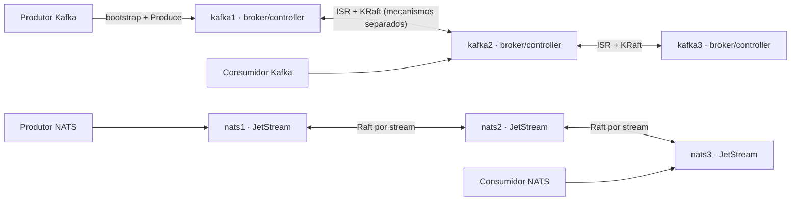
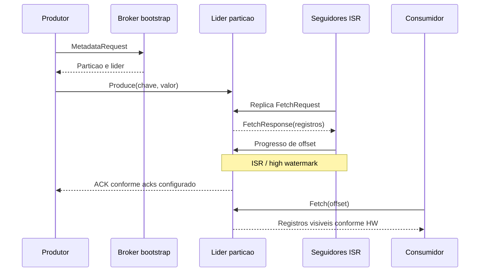
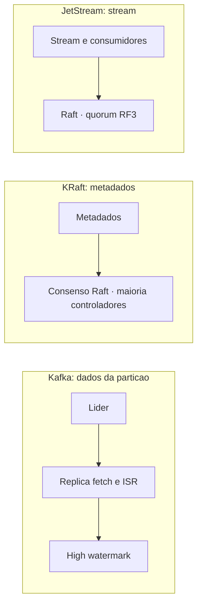
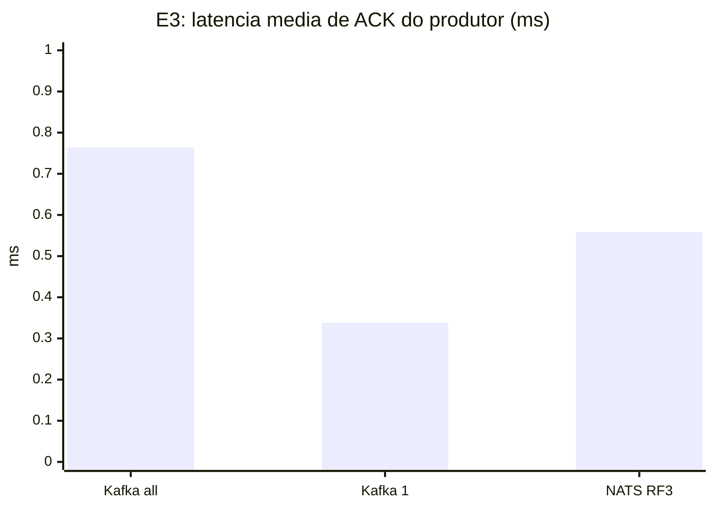
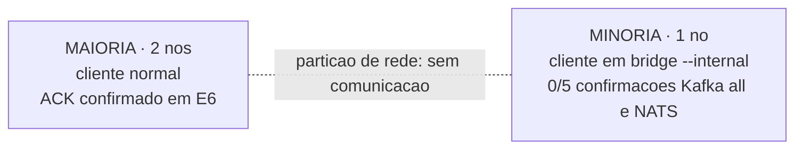
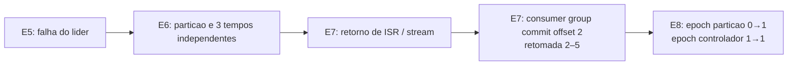

**RELATÓRIO ACADÊMICO — versão para revisão dos integrantes.**

**Tema 4 — Mensageria Publish–Subscribe (Kafka em modo KRaft)**  
**Ênfase D — Sistema similar: NATS JetStream**  
**Integrantes e matrículas:** [PREENCHER]  
**Turma e equipe:** [PREENCHER]  
**Instituição:** Universidade do Vale do Itajaí (UNIVALI)  
**Professor:** Ramices dos Santos Silva  
**Semestre:** 2026/2


# 1. Identificação e apresentação

**Instituição:** Universidade do Vale do Itajaí (UNIVALI). **Disciplina:** Sistemas Distribuídos. **Professor:** Ramices dos Santos Silva. **Período:** segundo semestre de 2026. **Trabalho:** M2 — Sistemas Distribuídos Reais na Prática, Tema 4 (Mensageria Publish–Subscribe); **Ênfase D** (sistema similar: Kafka KRaft × NATS JetStream).

**Equipe e integrantes:** **[PREENCHER: nome completo, matrícula, turma, integrantes e equipe]**. **Local e data de entrega:** **[PREENCHER]**. Estes campos não podem ser inferidos de commits, conta GitHub ou uso de ferramentas.

**Repositório:** https://github.com/leodbc/Pub-Sub-Architecture. **Evidências:** `docs/evidencias_experimentos.md`, commit `faae727`; release `m2-fase1-evidencias-2026-10-28`. **Fundamentação:** `docs/fundamentacao_e_questoes.md`, commit `87e9990`. O histórico de PRs e os arquivos originais são preservados.

# 2. Resumo

Este trabalho investiga a arquitetura, replicação, ordenação, coordenação e tolerância a falhas de um sistema publish–subscribe distribuído. O Apache Kafka 4.4.0, configurado com três processos combinando brokers e controladores KRaft, foi comparado ao NATS JetStream 2.10 em três nós (RF3), sob a Ênfase D do roteiro M2. Executaram-se os experimentos E1–E9 em contêineres Docker em runners Ubuntu do GitHub Actions, com cinco repetições das métricas temporais aplicáveis, coleta de logs e análise descritiva. O Kafka demonstrou ordem por partição, confirmações condicionadas a ISR e `min.insync.replicas`, retorno de réplicas e retomada de consumer group a partir do offset confirmado 2. O JetStream foi comparado por sua replicação Raft por stream e suas confirmações de publicação. Em partições controladas, a maioria manteve confirmações nos cenários ensaiados, enquanto a minoria isolada não confirmou escritas. ACK, leitura visível, propagação a cada follower, recuperação e consenso foram tratados como medidas diferentes. Os resultados descrevem uma topologia de laboratório em host compartilhado, não estabelecem superioridade universal nem substituem a verificação humana da entrega.

**Palavras-chave:** sistemas distribuídos; Kafka; KRaft; NATS JetStream; replicação; tolerância a falhas; publish–subscribe.

# 3. Fundamentação científica

## 3.1 Origem do problema e modelo de dados

Kafka foi originalmente proposto para captar e transportar grandes volumes de logs de eventos com baixa latência, unificando padrões de mensageria e processamento em lote e em tempo quase real (KREPS; NARKHEDE; RAO, 2011 [R1]). Eugster et al. (2003 [R2]) caracterizam publish–subscribe pelo desacoplamento espacial, temporal e de sincronização: produtor não precisa endereçar cada consumidor nem permanecer ativo durante o consumo. Tópicos Kafka se dividem em partições, cada qual um log append-only de registros com offsets locais; chaves estáveis ajudam a escolher a partição, sem conferir ordem global. Segmentação, retenção e offsets tornam possível repetir leitura de eventos retidos. O protocolo oferece bootstrap e metadados de partição e líder, que podem mudar durante failover [R3–R4].

O NATS Core oferece publicação e assinatura não persistente por subjects; JetStream acrescenta streams duráveis configuráveis, sequências por stream, consumidores com estados e ACKs, retenção e replay [R13–R15]. O comparador não deve ser reduzido a “fila”, porque um stream atende diferentes consumidores independentes. O Kafka combina fan-out por grupos e distribuição de partições dentro de cada grupo [R3, R12].

## 3.2 Arquiteturas e topologias

Os três nós Kafka do laboratório exercem simultaneamente os papéis `broker,controller`, sem que isso signifique recomendação para ambientes produtivos. A replicação de **dados** ocorre por líder e seguidores de **cada partição**, que buscam registros, integram o ISR quando atuais e avançam o high watermark (HW). A coordenação dos **metadados** ocorre em um **quórum KRaft distinto**, com log Raft e maioria de controladores (KIP-500 e KIP-595 [R7–R8]). Raft não é o algoritmo usado para replicar cada log de dados do Kafka. O estado dos consumidores é mantido por commits de offset e coordenação de grupos; o protocolo de rebalanceamento depende de versão/configuração [R3, R12].

JetStream usa grupos Raft por stream e por consumidor, além de grupo de metadados; grupo RF3 requer maioria 2/3 para avançar confirmações consistentes conforme configuração. Um PubAck é semântica de publicação do serviço, não equivalência automática a qualquer nível de ACK do Kafka [R13–R15].



*Figura 1 — Nós, redes e papéis configurados (sem atribuir líder fixo). Fonte: elaboração própria com base em arquivos Compose; EV-E1.*

## 3.3 Sequência de publicação, replicação e leitura

A chave e o particionador determinam o destino Kafka em condições fixas; o produtor descobre o líder pelos metadados, faz `Produce`, os seguidores replicam pelo protocolo de fetch e a resposta depende de `acks`. Em `acks=1`, o líder pode responder antes da confirmação pelas demais réplicas; em `acks=all`, a resposta exige o conjunto ISR atual e o mínimo configurado. Em geral, o consumidor só enxerga registros até a fronteira de confirmação HW; leitura transacional `read_committed` considera também LSO [R3–R6]. Com RF3 e ISR=3, `min.insync.replicas=2` é *piso* da cardinalidade, e não autorização para ignorar a terceira réplica ainda integrante do ISR.



*Figura 2 — Fluxo lógico de publicação/replicação/leitura; não é trace instrumentado. Fonte: elaboração própria com base em [R3–R6], EV-E2.*

## 3.4 Três mecanismos que não devem ser confundidos

Um **log de dados Kafka** é uma sequência líder–seguidor por partição e usa ISR/HW para fronteiras de visibilidade e durabilidade condicionada. Um **log de metadados KRaft** é um estado replicado com eleição e commit por maioria entre controladores. Um **stream JetStream RF3** possui grupo Raft próprio. A palavra “consenso” não transforma os três em protocolos equivalentes. O `min.insync.replicas` limita confirmações `acks=all`, mas não é uma votação Raft de cada mensagem Kafka. Como E8 demonstra, a época de líder de partição e a época do controlador são variáveis diferentes; ELR (KIP-966 [R9–R10]) introduz regra adicional de elegibilidade em versões atuais, mas seu acionamento específico não foi isolado neste laboratório.



*Figura 3 — Separação entre ISR/HW, KRaft e Raft dos streams JetStream. Fonte: elaboração própria com base em [R3, R7–R10, R14–R15].*

## 3.5 Entrega, falhas, segurança e limites de consistência

`at-most-once` significa possível perda sem repetição; `at-least-once` admite duplicação se há processamento sem commit ou retentativa ambígua; `exactly-once` em Kafka exige produtor idempotente, transação, controle de offset e fronteira de leitura/saída adequadamente configurados e não garante efeitos externos arbitrários [R3, R6]. JetStream suporta redelivery por ACK do consumidor e deduplicação de publicação configurável; isso também não equivale a transação arbitrária fim a fim [R13, R21].

Kafka e NATS descritos aqui assumem principalmente falhas não bizantinas; timeouts e heartbeats são suspeitas, não provas de perda de dados. CAP exige cuidado com a definição de consistência e disponibilidade; PACELC adiciona o compromisso entre latência e consistência sem partição [R19–R20]. As redes de laboratório usam listeners `PLAINTEXT` e não possuem controles recomendáveis de autenticação, autorização e criptografia para produção [R17].

# 4. Ambiente experimental e reprodutibilidade

Os ensaios foram executados por GitHub Actions em máquinas temporárias **Ubuntu 24.04, Linux x86_64** (kernel reportado no log de E1), Docker Engine **28.0.4**, Docker Compose **2.38.2** e Go **1.26.2**. O experimento utilizou imagens `apache/kafka-native:4.4.0`, cliente `apache/kafka:4.4.0`, `nats:2.10-alpine` e `natsio/nats-box:latest`; esta última é uma tag flutuante e é ameaça à reprodutibilidade binária. As versões são aquelas **observadas/configuradas no laboratório**, não descrição de infraestrutura física permanente. Modelo de CPU, número exato de vCPUs, memória total/disco e pressão de co-tenancy do runner **não foram instrumentados como inventário fechado** e exigem indicação de indisponibilidade, não ficção.

**Tabela 1 — Nós, interfaces e limites de memória configurados.**

| Nó/serviço | Papéis | Rede interna / porta | Rede clientes / porta | Limite de memória |
|---|---|---|---|---|
| kafka1 | broker + controller (ID 1) | 172.30.0.41:9092, :9093 | 172.31.0.41:19092 | 320 MiB (Docker `320m`) |
| kafka2 | broker + controller (ID 2) | 172.30.0.42:9092, :9093 | 172.31.0.42:19092 | 320 MiB |
| kafka3 | broker + controller (ID 3) | 172.30.0.43:9092, :9093 | 172.31.0.43:19092 | 320 MiB |
| cliente Kafka | sdtool / Kafka CLI | — | 172.31.0.100 | 512 MiB |
| nats1 | JetStream + roteamento | 172.32.0.51:6222 | 172.33.0.51:4222 | 128 MiB |
| nats2 | JetStream + roteamento | 172.32.0.52:6222 | 172.33.0.52:4222 | 128 MiB |
| nats3 | JetStream + roteamento | 172.32.0.53:6222 | 172.33.0.53:4222 | 128 MiB |
| cliente NATS | sdtool / nats CLI | — | 172.33.0.100 | 128 MiB |

*Fonte: elaboração própria a partir de `kafka/docker-compose.yml`, `nats/docker-compose.yml`, `host_info.log` e [EV-E1]. Os nomes de rede e IPs são internos ao Docker, não endereços de acesso externo. No Docker o sufixo `m` corresponde ao limite configurado em bytes da ferramenta, não à memória física exclusiva medida.*

O tópico `probe` foi descrito em E1 com fator de replicação 3, `min.insync.replicas=2`, líder de partição 1, ISR `1,2,3`. O quórum de controladores reportou líder 2 e `LeaderEpoch=1` **naquele instante**; o stream NATS `PROBE` reportou RF3 e líder nats3 no snapshot E1. Líderes podem mudar. Todos os nós são contêineres com armazenamento local ao runner; mecanismos físicos de disco, RAID e zonas não são testados.

**Reprodução mínima (conforme README versionado):** compilar a ferramenta pelo módulo Go; subir cada Compose; criar tópicos/streams via `sdtool setup`, verificar `kafka-topics.sh --describe`, `kafka-metadata-quorum.sh ... describe --status`, `nats stream info PROBE`; executar `sdtool probe/verify` e somente com ambiente limpo scripts e workflows históricos de E1–E9. Logs originais estão preservados na release: https://github.com/leodbc/Pub-Sub-Architecture/releases/tag/m2-fase1-evidencias-2026-10-28. Os hashes SHA-256 por ZIP e membro constam do manifesto. A disponibilidade futura da release depende da sua manutenção pelo proprietário; **não** rodar CI de falhas automaticamente para revisar somente a redação.

```bash
cd go && go mod download && CGO_ENABLED=0 GOOS=linux go build -mod=readonly -o bin/sdtool .
cd ../kafka && docker compose up -d
# dentro do cliente Kafka: /app/sdtool setup --sys kafka; /app/sdtool probe --sys kafka; /app/sdtool verify --sys kafka
cd ../nats && docker compose up -d
# dentro do cliente NATS: /app/sdtool setup --sys nats; /app/sdtool probe --sys nats; /app/sdtool verify --sys nats
```

# 5. Experimentos E1–E9: previsões, resultados e interpretação

O laboratório registra cinco ciclos onde o roteiro pede medidas temporais e utiliza **desvio padrão amostral** (denominador n−1). Os CSVs originais prevalecem sobre interpretação narrativa. **[F]** denota mecanismo documentado, **[O]** resultado observado, **[I]** interpretação fundamentada e **[L]** limitação/não medido. As previsões abaixo reproduzem as hipóteses operacionais registradas na base experimental, não uma previsão autoral retroativa.

## 5.1 E1 — Subida, topologia e papéis

**Objetivo e previsão:** levantar três brokers/controladores KRaft e três nós JetStream RF3; identificar líderes e réplicas. **Procedimento:** `docker compose up`, `sdtool setup` e consultas de tópico/quórum/stream. **[O]** `e1_kafka_topic.log`: líder 1, replicas/ISR 1,2,3, RF3; `e1_kafka_quorum.log`: controladores votantes 1,2,3, líder 2, época 1; `e1_nats_stream.log`: stream PROBE RF3, líder nats3 e duas réplicas atuais. **Análise:** a previsão foi corroborada como *snapshot*, não como mapeamento fixo de liderança durante toda a execução. Evidências EV-E1 e Figura 1.

## 5.2 E2 — Caminho da publicação/leitura

**Objetivo e previsão:** para chave constante, a partição escolhida se mantém na configuração fixa; offsets de escrita/leitura coincidem. **Procedimento:** 12 chaves × 3 mensagens = 36 publicações/leituras; comparar chave, partição e offset via processo observador independente. **[O]** `e2_keys.log` confirmou 36 `PRODUCE`, 36 `CONSUME`, 12 chaves estáveis, três partições, offsets correspondentes. **[L]** O mecanismo de metadados, replica fetch, líder e HW na Figura 2 provém de [R3–R4], **não foi rastreado por timestamp em cada salto**; especificamente E2 não demonstra, isoladamente, redescoberta dinâmica de líder. Fonte: EV-E2.

## 5.3 E3 — Replicação, ACK, vazão e visibilidade

**Objetivo e previsão:** RF3 replicado nos três nós; `acks=1` tende a reduzir custo de confirmação frente a `acks=all`, sem equivalência de durabilidade; JetStream RF3 tem protocolo distinto. **Procedimento:** benchmark de 200 mensagens/rodada, cinco rodadas por configuração, com log do `sdtool bench`; teste complementar separado de envio a callback do consumidor também em n=5. **[O]** E1 confirmou RF3 e ISR; o benchmark apresentou os valores da Tabela 2, sem erro contado nos ensaios. **[L]** ACK e callback **não** medem instante de escrita individual em cada follower. As tabelas do benchmark e do teste complementar não podem ser agregadas numa única média porque workloads e instrumentos diferem.

**Tabela 2 — Cinco repetições, média e desvio padrão amostral: latência ACK e vazão de E3.**

| Sistema/modo | Repetição | Latência média (ms) | Vazão (msg/s) | Erros | Evidência |
|---|---:|---:|---:|---:|---|
| Kafka acks=all | 1 | 0.84 | 1189.00 | 0 | `e3_kafka_acks_all.log` |
| Kafka acks=all | 2 | 0.74 | 1352.00 | 0 | `e3_kafka_acks_all.log` |
| Kafka acks=all | 3 | 0.81 | 1224.00 | 0 | `e3_kafka_acks_all.log` |
| Kafka acks=all | 4 | 0.72 | 1389.00 | 0 | `e3_kafka_acks_all.log` |
| Kafka acks=all | 5 | 0.71 | 1398.00 | 0 | `e3_kafka_acks_all.log` |
| **Kafka acks=all: média ± DP** | **5** | **0.764 ± 0.058** | **1310.400 ± 97.192** | — | — |
| Kafka acks=1 | 1 | 0.34 | 2890.00 | 0 | `e3_kafka_acks_1.log` |
| Kafka acks=1 | 2 | 0.40 | 2472.00 | 0 | `e3_kafka_acks_1.log` |
| Kafka acks=1 | 3 | 0.32 | 3097.00 | 0 | `e3_kafka_acks_1.log` |
| Kafka acks=1 | 4 | 0.32 | 3109.00 | 0 | `e3_kafka_acks_1.log` |
| Kafka acks=1 | 5 | 0.31 | 3152.00 | 0 | `e3_kafka_acks_1.log` |
| **Kafka acks=1: média ± DP** | **5** | **0.338 ± 0.036** | **2944.000 ± 282.665** | — | — |
| NATS RF3 | 1 | 0.56 | 1790.00 | 0 | `e3_nats_rf3.log` |
| NATS RF3 | 2 | 0.57 | 1738.00 | 0 | `e3_nats_rf3.log` |
| NATS RF3 | 3 | 0.56 | 1770.00 | 0 | `e3_nats_rf3.log` |
| NATS RF3 | 4 | 0.55 | 1795.00 | 0 | `e3_nats_rf3.log` |
| NATS RF3 | 5 | 0.55 | 1799.00 | 0 | `e3_nats_rf3.log` |
| **NATS RF3: média ± DP** | **5** | **0.558 ± 0.008** | **1778.400 ± 25.185** | — | — |

*Fonte: `resumo_estatistico.md`, `e3_kafka_acks_1.log`, `e3_kafka_acks_all.log`, `e3_nats_rf3.log` no artifact histórico E1–E4 de EV-E3. Latência em ms; vazão em mensagens/s; n=5 por modo.*



*Figura 4 — ACK e vazão do produtor nas três configurações (não equivalência de garantia). Fonte: elaboração própria com base em Tabela 2; EV-E3.*

**Tabela 3 — Teste complementar E3: amostras de ACK e observação do consumidor em milissegundos.**

| Sistema/modo | Rodada | ACK (ms) | Callback de leitura (ms) |
| --- | --- | --- | --- |
| kafka_all | 1 | 0,853 | 0,758 |
| kafka_all | 2 | 0,810 | 0,786 |
| kafka_all | 3 | 0,767 | 0,791 |
| kafka_all | 4 | 0,832 | 0,791 |
| kafka_all | 5 | 0,829 | 0,836 |
| kafka_1 | 1 | 0,288 | 0,830 |
| kafka_1 | 2 | 0,426 | 0,925 |
| kafka_1 | 3 | 0,325 | 0,790 |
| kafka_1 | 4 | 0,300 | 0,901 |
| kafka_1 | 5 | 0,306 | 0,776 |
| nats | 1 | 0,511 | 0,610 |
| nats | 2 | 0,557 | 0,629 |
| nats | 3 | 0,467 | 0,523 |
| nats | 4 | 0,555 | 0,543 |
| nats | 5 | 0,570 | 0,546 |

*Fonte: CSVs `kafka_all.csv`, `kafka_1.csv`, `nats.csv`, artifact #12849007298 (EV-E3). O callback pode anteceder o ACK; relógio monotônico no mesmo processo, sem acesso a offsets de followers.*

## 5.4 E4 — Ordenação e limite de consistência

**Objetivo e previsão:** preservar ordem de offset **dentro** de cada partição, não garantir sequência global entre partições. **Procedimento:** produzir em três partições (90 chaves) e verificar inversões por partição e na concatenação total. **[O]** `e4_kafka_multi_verify.log` apontou **zero inversões por partição e 71 inversões na leitura global concatenada**. **Análise:** a ordem local foi observada; não houve história temporal concorrente suficiente para demonstrar linearizabilidade, causalidade global, transações exactly-once ou consistência formal entre partições. Fonte EV-E4.

## 5.5 E5 — Falha de líder e perda de quórum

**Objetivo e previsão:** testar 3, 2 e 1 nó ativo e verificar leituras/escritas; na topologia com RF3, confirmação `acks=all`/PubAck de maioria deve falhar em condições típicas com só 1 nó. **Procedimento:** identificar e parar líder, parar segundo nó, classificar resposta da API, restaurar e repetir cinco vezes. **[O]** Tabela 4 mostra *todas as categorias por rodada*: com 1 nó, Kafka `acks=1` confirmou apenas **2/5** tentativas, não 5/5; `acks=all` e NATS PubAck não confirmaram nas cinco. Leituras com resultados `dados`/`vazio` não identificam necessariamente os mesmos registros previamente confirmados. Timeout é ausência de confirmação, não exclusão comprovada do registro.

**Tabela 4 — Matriz de disponibilidade observada por rodada E5 (não é prova formal de SLA).**

| Sistema / condição | Escrita ou leitura | Rodadas r1–r5 |
| --- | --- | --- |
| Kafka: 3 nós, acks=all | Escrita | OK, OK, OK, OK, OK |
| Kafka: 2 nós, acks=all | Escrita | OK, OK, OK, OK, OK |
| Kafka: 2 nós | Leitura API | vazio, dados, dados, vazio, dados |
| Kafka: 1 nó, acks=all | Escrita | timeout × 5 |
| Kafka: 1 nó, acks=1 | Escrita | timeout, timeout, OK, timeout, OK |
| Kafka: 1 nó | Leitura API | dados, vazio, dados, vazio, dados |
| NATS: 3 nós | PubAck | OK × 5 |
| NATS: 2 nós | PubAck | OK × 5 |
| NATS: 2 nós | Leitura API | dados × 5 |
| NATS: 1 nó | PubAck | timeout × 5 |
| NATS: 1 nó | Leitura API | erro, erro, timeout, timeout, erro |

*Fonte: `e5_5x_matrix.csv`, `e5_matriz.md`, artifact #12848882349 (EV-E5). `OK` indica ACK da operação observada; respostas de leitura vazia/dados são API, não garantia de identidade de registro.*


**Complemento normativo de metadados:** ao manter um controlador ativo e tentar `CreateTopics`, o cliente finalizou por timeout externo de **32,028 s**, sem confirmação no intervalo; o tópico apareceu **após restabelecimento do quórum**. **O instante de criação não foi instrumentado**. A materialização tardia não demonstra criação *durante* ausência de maioria. Fontes: `e5_create_without_quorum.log`, `e5_topic_postrestore.log`, `e5_create_classification.json`, `e5_late_materialization.json` (EV-E5).

## 5.6 E6 — Partição de rede com clientes isolados

**Objetivo e previsão:** isolar o líder de replicação e prover um cliente minoritário sem rota à maioria; confirmar escrita na maioria, recusar confirmação na minoria dentro da janela. **Procedimento:** bridge Docker `--internal` exclusiva para cliente da minoria e nó isolado; conferir rotas/interfaces e testar os dois lados, após isso reconectar e verificar saúde do cluster. **[O]** Kafka n=5: maioria escreveu e leu registro anterior nas cinco rodadas; minoria 0/5 ACKs `acks=all`; NATS: confirmação eventual na maioria e 0/5 PubAck e leituras confirmadas na minoria no intervalo. **[L]** leituras não confirmadas **não** provam perda definitiva. Três relógios diferentes devem ser mantidos separados: duração de partição (disconnect→início do reconnect), tempo até primeira confirmação majoritária (disconnect→ACK, incluindo retries) e tempo de recuperação após reconexão (connect→primeiro polling saudável). Todos incluem overhead experimental, não consenso interno.



*Figura 5 — Rede majoritária e minoria fisicamente isolada para cliente (cenário E6). Fonte: elaboração própria com base em EV-E6, network_proof.log e minority_interfaces.log.*

**Tabela 5 — E6 controlado: cinco medições de três grandezas separadas (ms).**

| Sistema | Rodada | Duração partição (ms) | Até 1º ACK maioria (ms) | Saúde após reconnect (ms) |
| --- | --- | --- | --- | --- |
| Kafka | 1 | 21.980,229 | 10.729,130 | 4.667,789 |
| Kafka | 2 | 24.586,725 | 13.375,941 | 1.922,225 |
| Kafka | 3 | 27.155,943 | 16.031,484 | 7.410,794 |
| Kafka | 4 | 22.002,401 | 10.707,087 | 1.964,879 |
| Kafka | 5 | 24.487,314 | 13.366,735 | 1.939,999 |
| Kafka média ± DP | n=5 | 24.042,522 ± 2.156,533 | 12.842,075 ± 2.222,348 | 3.581,137 ± 2.444,622 |
| NATS | 1 | 61.384,807 | 5.346,914 | 6.955,077 |
| NATS | 2 | 25.666,093 | 5.348,726 | 2.651,658 |
| NATS | 3 | 24.715,817 | 5.348,559 | 3.511,500 |
| NATS | 4 | 26.804,171 | 6.497,525 | 2.648,934 |
| NATS | 5 | 11.341,866 | 7.997,928 | 3.516,468 |
| NATS média ± DP | n=5 | 29.982,551 ± 18.641,682 | 6.107,930 ± 1.167,910 | 3.856,727 ± 1.785,055 |

*Fonte: `e6_clocks.csv`, `e6_operations.csv`, topologias e `summary.md` nos artifacts #12850545819 (Kafka) e #12851670501 (NATS); EV-E6. Séries em runners/datas diferentes; médias e DP calculados por n−1.*


**Comparação com E6 histórico:** os totais históricos `partition_to_healthy` (Kafka **26.805,9 ± 12.161,4 ms** e NATS **11.298,3 ± 4.291,5 ms**) juntavam intervenção, espera e recuperação; não devem substituir as três métricas acima. A comparação E9 usa apenas esse limite de validade e não chama esses números “tempo de consenso”.

## 5.7 E7 — Recuperação e retomada de consumidor

**Objetivo e previsão:** restaurar replicação após restart, observar ISR/Raft saudáveis; independentemente, testar onde o consumidor de grupo retoma após commit explícito. **Procedimento:** parar/religar nós, sondar estado até três réplicas atuais (cinco rodadas, Tabela 6); no complemento normativo, produzir offsets 0–5, consumir 0 e 1, confirmar próximo offset 2, encerrar processo e iniciar consumidor no mesmo grupo. **[O]** `e7_offset_after_crash.log` indica `CURRENT-OFFSET=2`; `e7_resumed.log` mostra consumo de **2–5**, sem reprocessar 0–1 nessa sequência. **[L]** recuperar o ISR é evento distinto do estado de consumo do grupo e não estabelece exactly-once para falhas arbitrárias. Fonte EV-E7.

## 5.8 E8 — Coordenação e épocas independentes

**Objetivo e previsão:** provocar troca de líderes e identificar contador correto. **Procedimento:** monitorar `kafka-metadata-quorum describe --status`, informações de partição e metagrupo JetStream; promover/derrubar líderes em cinco ciclos históricos, complementar com época de partição via Metadata API. **[O]** no normativo, a partição 0 mudou líder `2→3` e época `0→1`, enquanto a época do controlador KRaft ficou **`1→1`**. Eleições históricas do controlador foram registradas em outros ensaios, **não** nesse evento normativo. NATS informou líderes de metagrupo, mas **não forneceu termo Raft interno**, não estimá-lo. A coluna de tempos E8 da Tabela 6 mede intervenção/sondagem até troca observada, não duração pura da eleição. Fontes EV-E8.

**Tabela 6 — E5/E7/E8: tempos históricos individuais por rodada (ms).**

| Sistema | Rodada | E5: 1ª confirmação após falha (ms) | E7: retorno de réplicas (ms) | E8: troca coordenação observada (ms) |
| --- | --- | --- | --- | --- |
| KAFKA | 1 | 10.833,507 | 2.435,390 | 27.772,130 |
| KAFKA | 2 | 5.292,830 | 5.231,025 | 17.106,328 |
| KAFKA | 3 | 2.550,663 | 2.426,901 | 2.203,136 |
| KAFKA | 4 | 2.470,340 | 5.267,730 | 12.137,126 |
| KAFKA | 5 | 2.433,859 | 2.388,531 | 27.926,833 |
| KAFKA média ± DP | n=5 | 4.716,240 ± 3.629,617 | 3.549,915 ± 1.551,544 | 17.429,111 ± 10.921,536 |
| NATS | 1 | 213,926 | 1.251,961 | 139,014 |
| NATS | 2 | 208,404 | 3.026,429 | 130,477 |
| NATS | 3 | 205,121 | 3.918,423 | 3.139,511 |
| NATS | 4 | 2.217,447 | 3.008,742 | 135,409 |
| NATS | 5 | 220,912 | 1.266,951 | 8.148,192 |
| NATS média ± DP | n=5 | 613,162 ± 896,843 | 2.494,501 ± 1.185,931 | 2.338,521 ± 3.498,602 |

*Fonte: `medicoes_falhas.csv` (E5, E7), `medicoes_e6_e8.csv` (E8), ZIPs históricos E5–E7 e E6–E8; linhas originadas nos logs identificados em cada CSV (EV-E5, EV-E7, EV-E8). `E5` designa a primeira escrita confirmada após falha de líder, não duração de eleição; `E7` primeiro estado saudável detectado.*



*Figura 6 — Eventos operacionais E5–E8; sem igualar épocas ou relógios. Fonte: elaboração própria com base em EV-E5–EV-E8.*

## 5.9 E9 — Ênfase D: comparação Kafka × JetStream

**Objetivo e previsão:** executar E3–E8 em sistema similar, comparar unidade de replicação, consenso, ordem e falhas. **Procedimento:** consolidar séries de cinco repetições, inspeção de topologia, ACK e estados, com extensões normativas E2/E5/E7/E8 e metodológica E3/E6 preservadas separadamente. **[O]** Em E3, Kafka `acks=1` registrou menor ACK médio, Kafka `acks=all` maior ACK médio, JetStream RF3 valor intermediário; as garantias são diferentes. E5/E6 exibiram confirmação na maioria em topologias testadas, mas comportamento de minoria variou por protocolo e API. E7 verificou retorno de réplicas; E8 separou coordenação de partição e metadados.

**Síntese crítica:** Kafka oferece partições independentes e diversidade de topologias/grupos; as decisões de durabilidade dependem de líder, ISR, HW, `minISR` e ACK, enquanto KRaft regula metadados. JetStream privilegia subjects/streams e grupos Raft que coordenam estado do stream e de consumidores. O custo/benefício não é classificável a partir de cinco rodadas em um runner: não foram igualados tamanho/distribuição de mensagens, armazenamento físico, latências inter-região, backpressure real, múltiplos produtores concorrentes e cargas longas. Logo, **nenhum sistema é universalmente superior**; escolha depende de semântica e operação desejadas, não apenas de 0,338 versus 0,558 ms [R3, R13–R15; EV-E3–EV-E9].

**Tabela 7 — Comparação metodológica arquitetural e observacional da Ênfase D.**

| Aspecto | Kafka 4.4.0 KRaft | NATS JetStream RF3 | Natureza da evidência |
|---|---|---|---|
| Unidade de dados | log por partição | stream de subjects | [F] R3/R13 |
| Replicação de dados | líder, ISR e HW, sem Raft por partição | Raft por stream | [F] R3/R14 |
| Metadados | Raft KRaft entre controladores | meta Raft | [F] R7/R15; [O] E8 |
| ACK de publicação | `acks=1` líder / `acks=all` ISR | PubAck após regras de stream | [F] R3/R13; [O] E3 |
| Ordem | offsets por partição, não global | sequência por stream | [F] R3/R13; [O] E4 |
| Consumo | grupos, commits de offsets, rebalancing | consumers duráveis, redelivery por ACK | [F] R12/R21; [O] E7 Kafka |
| Falha da maioria | E5 `acks=all` sem confirmação com 1 nó; metadata timeout | E5 PubAck sem confirmação com 1 nó | [O] E5; não é prova de perda |
| Rede particionada | Kafka maioria 5/5 com `acks=all` | NATS maioria com PubAck eventual | [O] E6; clientes minoritários isolados |
| Recuperação | ISR/catch-up e offset de grupo independentes | réplica stream volta a atual | [O] E7; timers de laboratório |

# 6. Questões comuns Q1–Q14

As perguntas abaixo conservam a **redação literal do roteiro oficial, p. 8**; respostas foram editadas a partir da fundamentação versionada da Fase 2, com as mesmas referências `[R]` e evidências `EV-E`. A convenção [F/O/I/L] da seção 5 continua válida.

## Q1. Que problema de sistemas distribuídos o sistema resolve? Quais transparências ele oferece ao usuário (acesso, localização, replicação, falha, concorrência)?

**Resposta.** **[F]** Kafka distribui registros de eventos duráveis e reprocessáveis entre produtores e consumidores sem acoplamento direto, e enfrenta escala de vazão, replicação, recuperação e concorrência [R1–R3]. **Transparência de acesso**: APIs de publicação/consulta ocultam formatos internos de segmentos, mas exigem offsets/tópicos/partições explicitamente. **Localização**: clientes usam bootstrap e metadados para redescobrir líderes; IP/advertised listener precisa estar correto. **Replicação**: produtor interage com líder lógico e geralmente não escolhe follower; ISR afeta garantia e disponibilidade. **Falha**: retries/failover escondem parte das falhas, porém timeouts, rebalanceamentos, registros não comprometidos e erros são visíveis. **Concorrência**: múltiplos produtores/consumidores atuam, mas não existe serialização global entre partições; ordem por partição e consumo por grupo têm limites. **[O]** E1 prova três nós; E2 comprova chave, partição e offset apenas nas interfaces instrumentadas; redescoberta dinâmica de líderes é mecanismo documentado, não propriedade isoladamente provada por E2; E5/E6 mostram que falha **não** é transparente em todas as operações. **[L]** Essas transparências são **parciais**, não promessas universais [EV-E1, EV-E2, EV-E5, EV-E6].

## Q2. Qual é a arquitetura? Identifique estilo arquitetural (cliente-servidor, P2P, em camadas, centrado em dados, orientado a eventos), componentes e papéis. Apresente um diagrama próprio.

**Resposta.** **[F]** Externamente Kafka combina **cliente-servidor** (TCP producer/broker/consumer), **centrado em dados** (log de partições) e **orientado a eventos** (pub/sub), com camadas de acesso a dados, replicação e metadados. Internamente há comunicação ponto a ponto de brokers e controladores, sem ser um DHT/P2P aberto. Papéis: producer, leader/follower de partição, active/follower controller KRaft, consumer, group coordinator; no NATS, servidores roteadores, meta leader, stream leader, stream followers e consumers duráveis. O **diagrama autoral A.3** representa explicitamente os três brokers/controllers Kafka e o grupo NATS RF3. **[O]** E1: `e1_kafka_topic.log`, `e1_kafka_quorum.log`, `e1_nats_stream.log`; configs de Compose declaram papel e endereços. **[L]** Diagrama é representação de topologia e protocolo, não captura de pacotes [R3, R7, R14; EV-E1].

## Q3. Como um cliente localiza um dado ou serviço? A resolução é hierárquica, por consulta a um diretório central, ou calculada (hash, ...)?

**Resposta.** **[F]** O cliente Kafka conhece inicialmente um ou mais endereços bootstrap; a resposta *Metadata* revela brokers, tópicos, partições e líderes. A escolha de partição por chave usa política/particionador (frequentemente hash), não uma DHT global; a localização física do líder é **consultada nos metadados** (dinâmicos). O coordenador de grupo é escolhido a partir da partição de `__consumer_offsets` correspondente ao grupo; a localização também é obtida via protocolo. No NATS há subjects roteados pelos servidores; a alocação de streams é gerida pelo meta group, em contraste com hashing de partição Kafka. **[O]** E2 `e2_keys.log`: 12 chaves estáveis na mesma partição nas condições fixadas. **[L]** Não se provou resharding, troca de particionador nem continuidade dessa associação depois de mudar a contagem de partições [R3, R14; EV-E2].

## Q4. Como os nós se comunicam? Protocolo, síncrono ou assíncrono, direto ou indireto, serialização e semântica de entrega (no máximo uma, ao menos uma, exatamente uma).

**Resposta.** **[F]** Kafka oferece protocolo próprio de requests/responses binários sobre TCP, com serialização de batches (chave/valor e demais atributos); `Produce`, `Fetch`, `Metadata`, `OffsetCommit`, heartbeats e chamadas administrativas. Produtor emite assíncronamente com callback/future, ou aguarda a resposta no código cliente; follower faz *fetch* ao líder, e consumidor faz *pull*: há comunicação direta cliente-broker para transporte, **indireta** entre aplicativos por log persistente. NATS Core usa protocolo por subjects e NATS JetStream agrega APIs e ACKs de publicação/consumo. **[F]** At-most/at-least/exactly-once descrevem **efeito de processamento e entrega em escopo definido**; ACK de rede/servidor não equivale a efeito da aplicação. Kafka requer idempotência e transações para as condições de exactly-once, não configuração isolada de `acks=all` [R3, R4, R6, R13]. **[O]** E2 `e2_keys.log`, E3 `kafka_all.csv`/`kafka_1.csv`/`nats.csv`; E7 `e7_resumed.log`. **[L]** Não houve trace de cada salto nem experimento geral de efeitos externos exatamente uma vez [EV-E2, EV-E3, EV-E7].

## Q5. Qual é o modelo de replicação? Primário-backup, multilíder, sem líder (quórum) ou máquina de estados replicada? Quantas réplicas e quem aceita escritas?

**Resposta.** **[F]** Para **dados Kafka**, cada partição aplica líder/seguidores (*primary-backup*, single-leader), três cópias configuradas (RF3), followers buscando registros; o líder aceita `Produce`, podendo haver encaminhamento/erro até descobrir o atual. O ISR/HW gerencia commit/elegibilidade, **não** um grupo Raft majoritário por partição. Para **metadados Kafka**, três controladores formam log de máquina de estados replicada por KRaft/Raft, um controlador ativo aplica decisões com maioria de votantes. Para **dados NATS JetStream**, stream RF3 replica com Raft por grupo de stream, líder aceita/grava e confirma quando o grupo compromete. **[O]** E1 logs `e1_kafka_topic.log`, `e1_kafka_quorum.log`, `e1_nats_stream.log`; E3 benchmark `e3_kafka_acks_all.log`/`e3_nats_rf3.log`. **[L]** “O Kafka usa Raft para todas as partições” é incorreto [R3, R7, R8, R14; EV-E1, EV-E3].

## Q6. Qual modelo de consistência o sistema oferece (linearizável, sequencial, causal, eventual, leitura das próprias escritas)? Demonstre com experimento.

**Resposta.** **[F]** A noção pertinente ao Kafka é um **log ordenado por partição**, com fronteira de registros confirmados HW, e *read_committed* respeitando adicionalmente LSO transacional. Se cliente lê o mesmo log comprometido em ordem, há ordem consistente de offsets; **isso, isoladamente, não constitui prova formal de linearizabilidade de operações concorrentes** nem ordem global entre partições. Atributos de causalidade entre partições não são assegurados automaticamente. Leitura das próprias escritas pode ocorrer depois de ACK de escrita comprometida com leitura da partição apropriada e visibilidade compatível; configuração/isolation e erros importam. NATS stream mantém sequência própria de registros comprometidos, mas sem teste de história concorrente linearizável. **[O]** E4 `e4_kafka_multi_verify.log`: **zero inversões por partição** e **71 inversões na concatenação global** (90 chaves/3 partições); E2 `e2_keys.log` mostra offsets iguais. E3 mediu callback e ACK; não comprovou ordem temporal de linearização. **[L]** Sem teste de concorrência e história com tempos de invocação/resposta, não atribuir linearizabilidade, causalidade global ou consistência eventual como garantias demonstradas. **[I]** O sistema favorece consistência do prefixo comprometido da partição, sujeito às condições de ISR e eleição [R3, R4, R18; EV-E2, EV-E3, EV-E4].

## Q7. O sistema usa quórum? Quais são N, R e W (ou a maioria exigida)? Vale R + W > N? Quantas falhas f ele tolera com quantos nós? Demonstre perdendo o quórum.

**Resposta.** **[F]** Para controladores KRaft e stream Raft RF3 NATS, `N=3`, maioria `⌊N/2⌋+1=2`, tolerância `f=1` falha para progresso sob hipóteses usuais. Raft usa **quóruns majoritários intersectantes de eleições/commit**; não é apropriado atribuir arbitrariamente `R=2, W=2` a APIs de leitura Kafka/NATS: quóruns de votação/replicação não são automaticamente o modelo Dynamo de leituras/escritas `R+W>N`. Numa abstração de quorum clássico com `N=3`, `R=2,W=2` satisfaz `R+W>N`, mas **não** descreve necessariamente as operações desses produtos. Kafka **dados**: ISR variável, RF3, `min.insync.replicas=2` e `acks=all` exige ISR suficiente e confirmação das réplicas sincronizadas; `acks=1` não opera via quorum de maioria. **[O]** E5 `e5_5x_matrix.csv`: Kafka `acks=all` confirmou 5/5 com 3 ou 2 nós; com um nó, timeout 5/5. Kafka `acks=1` com um nó: confirmou **2/5**, timeout **3/5**; não exigir disponibilidade permanente. NATS PubAck 5/5 com 3 ou 2; 0/5 confirmações com 1. E5 `e5_create_without_quorum.log`: sem maioria de controladores, CreateTopics não confirmou, embora o tópico aparecesse após restauração. **[L]** Timeouts não demonstram perdas e uma configuração RF3/ISR não determina isoladamente o resultado de todo endpoint [R3, R7, R11, R14; EV-E5].

## Q8. Existe líder, primário ou coordenador? Como é escolhido (estático, Raft, Paxos, ZAB, controlador)? Compare com Bully e Anel.

**Resposta.** **[F]** Há três eleições conceitualmente distintas: controlador ativo Kafka é eleito via votos do quórum KRaft/Raft; líderes de partições são selecionados/coordenados pelo plano de controle Kafka, normalmente dentre réplicas elegíveis (ISR e regras atuais/ELR), não por votação Raft independente entre três cópias da partição; NATS meta leader e stream leader são escolhidos pelos respectivos grupos Raft. O coordenador de consumer group é um broker com responsabilidade pela partição interna do grupo, não líder eleito pelos consumidores via Bully/Anel. **Bully** e **Anel** escolhem um coordenador com base em IDs/comunicação, mas, por si, **não** fornecem consenso sobre log, compromisso majoritário, fencing e recuperação de histórico; Raft relaciona eleição, termos e integridade do log. **[O]** E8 histórico `e8_metagrupo.md` e `e8_nats_r*_elected.txt`: trocas de líderes; E8 normativo `e8_epoch_comparison.json`: época da partição muda, controlador constante. **[L]** Não houve observação direta do termo Raft interno NATS [R7, R8, R11; EV-E8].

## Q9. Como o sistema ordena eventos ou versões (número serial, época, termo, offset, revisão, carimbo de tempo)? Relacione com relógios de Lamport e vetoriais e com multicast ordenado.

**Resposta.** **[F]** Offset representa ordem **total local a uma partição**; log end offset, high watermark, épocas de liderança e metadados compõem outros domínios. Em KRaft, época/termo ordena mandatos do controlador e índice/offset ordena seu log. A época de uma partição identifica sucessão de líderes daquela partição. No JetStream, stream sequence ordena o stream e termos Raft ordenam eleições internas. **Relógio de Lamport** captura a relação *happens-before* em uma ordem lógica que pode ser estendida a uma ordem total arbitrária com desempate; **vetoriais** permitem distinguir causalidade de concorrência, não sendo um campo nativo inferível dos offsets Kafka. *Multicast totalmente ordenado* exigiria que todas as entregas relevantes concordassem sobre a mesma ordem global; Kafka **não** oferece tal ordem entre partições, embora possa ordenar dentro de uma única partição. **[O]** E4 0 inversões locais/71 globais; E8 época de partição `0→1` e de controlador `1→1`. **[L]** Timestamp wall-clock do registro pode refletir produtor/append e não prova causalidade nem relógios independentes [R3, R11, R18; EV-E4, EV-E8].

## Q10. Qual modelo de falhas é assumido (parada, omissão, bizantina)? Como as falhas são detectadas (heartbeats, timeouts)? O que acontece com a falha de 1 nó e com a falha da maioria?

**Resposta.** **[F]** As garantias usuais do Kafka/JetStream cobrem falha por parada, falha de rede/omissão e atraso em modelo parcialmente síncrono para progresso de eleições. Controladores Kafka monitoram brokers por heartbeats; Raft identifica indisponibilidade de líder via timeout de eleição/heartbeats e de seguidores via replicação; grupos de consumidores usam heartbeats/leases de sessão; ISR responde à falta de progresso da réplica. Detectores baseados em tempo podem suspeitar de nó lento sem comprovar parada. **Não** são protocolos de consenso tolerantes a servidores bizantinos. Com um nó parado, dois votantes Raft e (nas condições configuradas) cópias suficientes de dados permitem progresso; com dois, falta maioria, metadados novos e streams RF3 ficam indisponíveis para confirmação. Kafka `acks=1` pode **às vezes** responder sem min ISR, mas não há garantia global de disponibilidade quando se perdeu também coordenação. **[O]** E5 matriz das cinco repetições e E6 `e6_operations.csv`/`e6_clocks.csv`; **[L]** falhas de energia, corrupção de disco e adversários maliciosos não foram ensaiados [R3, R7, R11, R14; EV-E5, EV-E6].

## Q11. Diante de uma partição de rede, o sistema prioriza consistência ou disponibilidade? Sustente com o experimento E6 (pesquise o teorema CAP e a extensão PACELC).

**Resposta.** **[F]** Sob partição, *consistência* em CAP significa tipicamente propriedade próxima de **linearizabilidade de um objeto abstrato**, e *disponibilidade* significa **toda requisição de nó não falho terminar com resposta apropriada**, não apenas 'a maioria operou'. Gilbert e Lynch formalizam a impossibilidade de assegurar simultaneamente ambas sob particionamento arbitrário [R19]. PACELC separa **P**: escolha disponibilidade/consistência durante partição, e **EL**: troca entre latência e consistência sem partição [R20]. **[I]** Kafka `acks=all` com `min ISR=2`, KRaft maioria e JetStream RF3 privilegiam confirmação consistente sob hipóteses do protocolo e podem sacrificar disponibilidade na **minoria**. Não faz sentido rotular o **sistema inteiro** como simplesmente CP para todas as operações e configurações: `acks=1`, dados existentes, descoberta de líder, leitura, retenção e disponibilidade de metadados têm condições distintas.

**[O]** E6 isolou fisicamente um cliente minoritário em bridge Docker interna exclusiva e o cliente majoritário na rede original. Kafka, cinco rodadas: escrita confirmada na maioria 5/5, registro anterior visível lá e 0 confirmações `acks=all` na minoria; NATS, 5 rodadas: maioria teve ACK eventual e registro anterior; minoria 0/5 confirmações e 0/5 leituras confirmadas no intervalo. Kafka E6: duração da partição **24.042,522 ± 2.156,533 ms**, tempo da desconexão ao primeiro ACK da maioria **12.842,075 ± 2.222,348 ms**, saúde após reconectar **3.581,137 ± 2.444,622 ms**. NATS: **29.982,551 ± 18.641,682 ms**, **6.107,930 ± 1.167,910 ms**, **3.856,727 ± 1.785,055 ms**. **[L]** Séries em runners/datas diferentes, com ações de Docker, sondagem, reconexão e retentativas: **não são tempos internos de consenso**; a ausência de leitura na minoria na janela não prova perda de mensagens ou impossibilidade universal de qualquer leitura. E6 não é prova matemática do CAP, mas é observação compatível com previsões específicas [EV-E6].

## Q12. Como um nó que volta (ou um nó novo) recupera o estado? Log, snapshot, transferência completa ou incremental? Relacione com estado global e snapshots.

**Resposta.** **[F]** Um follower Kafka reentra e compara posições/épocas, obtendo registros faltantes do líder; se havia divergência, precisa conciliar o log com a liderança válida e o high watermark. A sincronização é tipicamente incremental quando o histórico necessário ainda existe; mecanismos de retenção e recomposição podem exigir recuperação maior. KRaft faz replay do log de metadados e snapshots quando apropriado. JetStream usa reconciliação do log Raft e mecanismos de snapshot/backup com semântica própria. **Não** há identidade automática entre 'o arquivo existe no nó' e 'ambas as réplicas têm o mesmo prefixo confirmado'. **Chandy–Lamport** obtém snapshot distribuído de cortes locais e mensagens em trânsito para detectar estado global consistente; snapshot Kafka de compactação/checkpoint é outra finalidade e não constitui automaticamente um corte distribuído Chandy–Lamport. **[O]** E7 `medicoes_falhas.csv`, logs de ISR/stream e `verify`: Kafka **3.549,9 ± 1.551,5 ms**, NATS **2.494,5 ± 1.185,9 ms** para recuperar estado saudável (n=5); complemento `e7_resumed.log` mostra retomada de **consumidor**, que é propriedade diferente da recuperação de réplica. **[L]** Não houve captura atômica do estado global nem prova bit a bit de todos os segmentos [R3, R11, R15, R16; EV-E7].

## Q13. Quais problemas clássicos aparecem no sistema (eleição, exclusão mútua, consenso, multicast ordenado, generais bizantinos) e como ele os resolve ou os evita?

**Resposta.** **[F]** **Eleição**: controlador KRaft e líderes Raft JetStream usam épocas/votos; líderes de partições Kafka são atribuídos pelo controlador com elegibilidade e fencing. **Consenso**: presente no metagrupo Kafka e nos grupos Raft JetStream, não é equivalente a replicação ISR de dados. **Exclusão mútua**: líder único por partição/termo é uma forma de serialização de append e fencing; não se trata de serviço geral de mutex distribuído para aplicações. **Multicast ordenado**: eventos da mesma partição/stream têm ordem acordada no seu escopo; não há multicast global por Kafka multilpartição. **Generais bizantinos**: arquitetura convencional não oferece tolerância BFT; autenticidade e integridade dependem de controles externos. Na impossibilidade FLP, consenso determinístico não garante término num ambiente totalmente assíncrono com falhas por parada; por isso timeouts e sincronia eventual afetam *liveness*, preservando segurança sob hipóteses apropriadas. **[O]** E4 comprova escopo local da ordem; E5/E6 demonstram redução de disponibilidade; E8 observa eleições/épocas. **[L]** Nenhum teste de nó malicioso ou demonstração formal de safety/liveness foi executado [R3, R7, R11, R18, R19; EV-E4, EV-E5, EV-E6, EV-E8].

## Q14. Onde o sistema é usado na prática, quais são suas limitações e que cuidados de segurança exige?

**Resposta.** **[F]** O caso originário documentado foi o pipeline de logs de grande volume da LinkedIn [R1]. Usos típicos incluem *event streaming*, auditoria e CDC, processamento assíncrono, integração de microsserviços e analytics; JetStream atende distribuição por subjects, retenção e workloads que precisam de consumidores duráveis [R3, R13]. **Limitações:** compromisso entre número de partições e ordem, custos de retenção/disco, latência de `acks=all`, impacto de ISR pequeno, throughput condicionado a batch/carga/recursos, coordenação de consumer groups, transações Kafka limitadas em escopo e ausência de exactly-once automático para banco externo. **Segurança:** TLS entre clientes/brokers/controladores, autenticação SASL/mTLS conforme produto, ACLs por tópicos/grupos, credenciais NATS e *accounts*/permissions, mínima exposição de listeners/monitoramento, segregação de redes, gestão de segredos, audit logs, quotas, patches, backups/restore e testes periódicos. **[O]** `kafka/docker-compose.yml` mostra `PLAINTEXT`, e `nats/docker-compose.yml` não configura autenticação; não publicar esse Compose para a internet. E3 revela latência/vazão *local*, E5/E6 as falhas, E7 recuperação. **[L]** Sem auditoria de segurança, carga em nuvem, hardware independente ou teste de produção, os resultados não atestam SLA real nem segurança operacional [R1, R3, R13, R17; EV-E3, EV-E5, EV-E6, EV-E7].


# 7. Questões específicas do Tema 4 — S1–S4

Transcrição literal do roteiro oficial, seção 8.4, p. 33, com aplicação à Ênfase D e limites observados.

## S1. Por que se diz que um log replicado é uma forma de máquina de estados replicada? Por que o Kafka garante ordem total apenas dentro de uma partição? Relacione com o sequenciador do Trabalho 1.

**Resposta.** **[F]** Uma *máquina de estados replicada* (SMR) pressupõe que réplicas partem de estado equivalente e **aplicam os mesmos comandos em ordem comum, determinística**, de modo a obter estados equivalentes. O *log replicado* é o mecanismo que pode fornecer a ordem comum; **um arquivo replicado por si só não é automaticamente uma SMR**, pois é preciso definir interpretação/aplicação, atomicidade, estado inicial e recuperação [R11]. KRaft usa log de **metadados** para sustentar estado replicado dos controladores. Para dados Kafka, réplicas de **uma partição** mantêm prefixo de registros sob regras de líder, ISR e high watermark, e um consumidor ordena a leitura pelo offset; isso não é idêntico a cada aplicação de consumidor processar deterministicamente o mesmo comando.

**Exemplo:** se o tópico `pedidos` tem partições 0,1,2, as posições `(0,7)` e `(1,7)` são incomparáveis como ordem global. Chaves constantes tendem à mesma partição na configuração fixa, mantendo FIFO daquele fluxo enquanto pressupostos de produtor/retries são respeitados. Um **sequenciador global** do Trabalho 1 ordenaria todos os eventos por número único antes de disseminar, impondo um ponto de serialização; Kafka obtém paralelismo ao evitar tal sequenciador global. Uma única partição ou sequenciador externo daria ordem total **nesse escopo**, com custo de paralelismo/gargalo e sem resolver magicamente causalidade de efeitos externos. **[O]** E4 `e4_kafka_multi_verify.log`: 0 inversões por partição e 71 na leitura concatenada; E2 `e2_keys.log`: 36 registros roteados por chave. **[L]** Não possuímos código/artefato original do Trabalho 1 nesta evidência; a comparação refere-se ao **modelo de sequenciador mencionado pelo PDF**, não a uma análise validada daquela implementação particular [R1, R3, R11, R18; EV-E2, EV-E4].

## S2. Compare as semânticas de entrega do Kafka (no máximo uma, ao menos uma, exatamente uma) com as semânticas de invocação remota vistas na Unidade 3 (talvez, ao menos uma, no máximo uma).

**Resposta.** **[F]** Em RPC, **talvez (*maybe*)** significa que uma chamada pode ou não executar sem garantia de resultado diante de falha (sem retry adequado); **ao menos uma** usa retries, podendo executar efeito mais de uma vez; **no máximo uma** depende de identificação/deduplicação e pode deixar a operação sem execução, mas nunca repeti-la na janela/escopo garantido. Essas são semânticas de **invocação/execução remota**; não equivalem literalmente às de **entrega/consumo** de um log. Em Kafka, **at-most-once** pode ocorrer com commit de offset antes do processamento (perda pós-crash); **at-least-once** com processamento antes do commit (reprocessamento pós-crash); **exactly-once** depende de produtor idempotente/transações e *offset commits* atômicos com saída Kafka, consumidores `read_committed` e condições documentadas; não há transação automática de efeitos remotos. A resposta RPC pode perder-se embora a execução tenha ocorrido; analogamente, timeout de `Produce` pode ocultar registro gravado (resultado **ambíguo**), justificando deduplicação e consulta do estado em vez de declarar perda. A idempotência do produtor evita certas duplicações no log, mas não impede duas chamadas semanticamente iguais emitidas intencionalmente nem a duplicação de efeito em API externa [R3, R6].

| Situação | Possível resultado | Medida de mitigação |
|---|---|---|
| RPC talvez / Kafka sem espera confiável | chamada ou publicação sem resultado inequívoco | consulta/reconciliação e identificador de operação |
| RPC ao menos uma / Kafka commit depois de processar | execução ou entrega repetida | função/consumidor idempotente e deduplicação |
| RPC no máximo uma / Kafka commit antes de processar | ausência de execução ou perda de processamento | aceitar perda ou reprojetar confirmação |
| Kafka exactly-once **no escopo transacional** | saída Kafka e offset confirmados atomicamente | idempotência, transação, isolamento apropriado |

**[O]** E7 commit `2` e retomada `2–5` prova apenas a sequência ensaiada; E3 distingue ACK e callback. **[L]** E1–E9 não testaram ponta a ponta uma transação entre Kafka e banco externo; não se reivindica tal garantia [EV-E3, EV-E7].

## S3. Compare o modelo ISR (tolera f falhas com f + 1 réplicas) com o quórum majoritário do Raft (2f + 1). Qual o papel do min.insync.replicas nessa conta?

**Resposta.** **[F]** A expressão didática “ISR tolera `f` falhas com `f+1` réplicas” diz respeito a **existir ao menos uma cópia elegível sobrevivente de entradas comprometidas**, se elas foram replicadas ao ISR requerido, não se perdeu armazenamento e não se escolheu líder sujo. **Não é uma fórmula de disponibilidade de novas escritas `acks=all`**: para continuar confirmando, a cardinalidade atual do ISR tem de ser pelo menos `min.insync.replicas`, e o líder deve contar com progresso das réplicas do ISR. Assim, se RF3, ISR inicial `{1,2,3}`, `minISR=2`: uma falha deixa dois ISR em condições típicas e acks=all pode progredir; duas falhas deixam um, e acks=all deixa de confirmar. Com minISR=3, **até uma** falha já pode impedir novos ACKs `all`. Com minISR=1, escrita pode continuar com cópia única e maior exposição à perda. `acks=1` **não** exige o mesmo compromisso do ISR nem quórum de maioria e pode confirmar localmente, mas lideranças/metadados e conexões podem impedir progresso.

**Raft** em configuração estável com `N=2f+1` votantes, por sua vez, exige interseção de **maiorias** para eleger/comprometer alterações; em `N=3`, `f=1`. KRaft aplica isso ao **metalog**, não à replicação de cada partição Kafka. NATS JetStream RF3 aplica maioria ao **grupo Raft do stream**. **Contraexemplo à equivalência:** se Kafka reduz ISR de 3 para 2, `acks=all` requer ambas as 2 **que pertencem ao ISR**, mesmo que o terceiro votante do KRaft esteja ativo; Raft do metagrupo pode prosseguir enquanto a partição não aceita novas escritas, e vice-versa quando há alterações de metadados pendentes. Com Kafka 4.4 há ainda elegibilidade ELR condicionada à configuração (KIP-966); não substituir regras operacionais verificadas por uma máxima sem qualificadores [R3, R5, R7–R10]. **[O]** E5 `e5_5x_matrix.csv`: Kafka acks=all 5/5 com dois nós, timeout 5/5 com um; acks=1 só 2/5 com um; NATS RF3 5/5 com dois e timeout 5/5 com um. E5 `e5_create_classification.json` e `e5_late_materialization.json` tornam **indeterminada** a data/instante da criação pós-timeout. **[L]** Não houve prova de todos os padrões possíveis de degradação de ISR/ELR [EV-E5].

## S4. Como o Kafka unifica os modelos publish-subscribe e fila de mensagens por meio de grupos de consumidores? Quem coordena o rebalanceamento?

**Resposta.** **[F]** Se `pedidos` tem 3 partições, um grupo `estoque` com 3 consumidores pode receber uma partição por consumidor; um quarto consumidor do **mesmo** grupo pode ficar ocioso (salvo mecanismos distintos de compartilhamento), porque a unidade de atribuição é a partição. Outro grupo `faturamento` lê **os mesmos registros** de forma independente (pub/sub). Dentro de cada grupo, há **divisão de trabalho parecida com fila**: cada partição pertence a um membro do grupo por vez no protocolo de atribuição; redelivery e reprocessamento ainda podem ocorrer, não se trata de fila destrutiva universal. O broker **coordenador de grupo** mantém estado/commits e gerencia o protocolo com membros. No protocolo **clássico**, um membro líder efetua a atribuição conforme assignor; no protocolo de rebalanceamento **mais recente**, o coordenador e atribuição do lado do servidor participam diretamente, sendo necessário não fundir esses mecanismos. Heartbeats, tempo de sessão, revogações e geração/época governam rebalanceamento. O **controlador KRaft** não é o *group coordinator* dos consumidores [R3, R12].

**[O]** E7 normativo, `e7_first_interrupted.log`/`e7_offset_after_crash.log`/`e7_resumed.log`/`e7_assertions.json`: o novo processo **no mesmo grupo** retomou do offset confirmado `2`, lendo `2–5`. **[L]** O experimento demonstra continuidade do offset de grupo e a atribuição que permitiu leitura, não mede tempo de rebalanceamento nem teste de 1→3→4 consumidores (isso é ênfase C, **não exigida** pela Ênfase D) [EV-E7].


# 8. Quadro-síntese obrigatório

**Tabela 8 — Quadro-síntese da página 41 do roteiro, preenchido para Kafka e comparativo NATS.**

| Aspecto do modelo oficial | Resposta da equipe fundamentada em observação |
|---|---|
| Estilo arquitetural e papéis | Orientado a eventos, centrado em logs; Kafka produtor, broker, controlador KRaft, consumidores/grupos. JetStream publicador, servidores, streams, consumers [EV-E1, Fig. 1]. |
| Como dado/serviço é localizado | Bootstrap e metadata para líderes de partição; chave encaminha a partição; subjects/streams NATS [R3, R13; EV-E2]. Redescoberta dinâmica de líder é [F], não resultado isolado de E2. |
| Modelo de replicação (N; quem aceita escritas) | Kafka RF3, líder da partição recebe Produce, seguidores no ISR replicam; JetStream RF3 stream Raft com líder [EV-E1, EV-E3]. |
| Modelo de consistência observado | Ordem local por offset e fronteira de visibilidade; E4 zero inversões por partição, 71 na leitura global concatenada. Linearizabilidade geral não testada [EV-E4]. |
| Quórum N, R, W e falhas toleradas | Kafka minISR=2 para `acks=all`; KRaft 2/3 para metadados. JetStream stream Raft 2/3. Não aplicar R+W>N mecanicamente ao ISR. E5: 1 nó não confirmou `acks=all` ou PubAck [EV-E5]. |
| Líder/coordenador e eleição | Kafka líderes de partição separados do líder dos controladores; E8 épocas partição `0→1`, controlador `1→1`; NATS líder do stream e metagrupo, sem termo interno observado [EV-E8]. |
| Ordenação/versionamento | Kafka offset+leader epoch por partição; metadados KRaft têm época própria; JetStream sequências por stream, termos Raft não exibidos na coleta [EV-E2, EV-E4, EV-E8]. |
| Comportamento sob partição C ou A | Sob E6, lado majoritário confirmou escritas e minoritário não confirmou no intervalo; propriedades condicionadas a operação/configuração, não prova global do CAP [EV-E6, R19–R20]. |
| Recuperação | Catch-up e retorno a ISR/current em cinco ciclos; consumer group Kafka recuperou offset 2 e consumiu 2–5 [EV-E7]. |
| Problemas clássicos presentes e tratamento | Eleição e consenso no metaplano KRaft e grupos JetStream; ordem de log local, deduplicação/ACK condicionais, timeouts e falhas por omissão, sem tolerância bizantina [EV-E5–EV-E8, R11]. |

*Fonte: elaboração própria segundo quadro do roteiro UNIVALI, p. 41, e logs EV-E1–EV-E8. Todas as dez linhas obrigatórias foram preenchidas. “C ou A” é contextualizado por operação.*

# 9. Limitações e ameaças à validade

**Validade interna.** Falha de líder não é sinônimo de falha do grupo de metadados; parada de dois processos afeta planos de dados e controle. O E5 apresentou materialização tardia após timeout de `CreateTopics`; instante de criação desconhecido. A confirmação de `acks=1` com um nó foi 2/5, não se devem inventar cinco confirmações. É possível misturar retry do cliente, coleta de estado e tempo de estabilização do cluster ao estimar recuperação. Em E6 o isolamento minoritário foi corrigido com bridge exclusiva; dados de tentativas históricas não devem ser tratados como a mesma topologia.

**Validade de construto e medição.** E3 ACK e callback não medem replicação individual nem flush fsync em três réplicas. E4 não fez história concorrente linearizável. E6 mediu duração da partição, tempo até primeiro ACK da maioria e saúde após reconectar, com custo de Docker, callbacks, polled health e retries; séries Kafka e NATS foram capturadas em runners/datas diferentes. E7 tempo de ISR/current difere de recuperação de consumer group (offset 2). E8 época de partição e época do controlador são domínios distintos, e termo meta Raft NATS não foi exposto. Os desvios n=5 são **amostrais** e não fundamentam teste estatístico causal sem desenho adequado.

**Validade externa.** Um runner virtual único não reproduz zonas de disponibilidade, falhas de disco, clock skew controlado, latência WAN, diversidade de hardware, cargas concorrentes de produção ou operações de segurança. Imagens com tag flutuante e limites configurados não são prova de capacidade real. A medição E9 não equipara semanticamente `acks=1`, `acks=all` e PubAck RF3.

**Validade documental.** Referências [R] incluem artigos revisados, propostas KIP, documentação de fornecedor e fontes primárias. Uma KIP enuncia especificação/proposta; comportamento implementado depende da versão/flags. `ELR` aparece em documentação Kafka 4.4, mas seu acionamento efetivo não foi ensaiado. Todos os resultados trazem caminhos dos logs e são confrontáveis com ZIPs da release. A verificação final das fontes e da conformidade acadêmica cabe aos alunos.

# 10. Participação individual dos integrantes

**[PREENCHER OBRIGATORIAMENTE POR CADA INTEGRANTE — NÃO INFERIR]**

| Integrante (nome completo / matrícula) | Pesquisa e bibliografia | Implementação / Docker / Go | Execução e coleta | Análise / relatório | Revisão e arguição |
|---|---|---|---|---|---|
| [INTEGRANTE 1] | [descrever efetivo] | [descrever efetivo] | [descrever efetivo] | [descrever efetivo] | [descrever efetivo] |
| [INTEGRANTE 2, se houver] | [descrever efetivo] | [descrever efetivo] | [descrever efetivo] | [descrever efetivo] | [descrever efetivo] |
| [INTEGRANTE 3, se houver] | [descrever efetivo] | [descrever efetivo] | [descrever efetivo] | [descrever efetivo] | [descrever efetivo] |
| [INTEGRANTE 4, se houver] | [descrever efetivo] | [descrever efetivo] | [descrever efetivo] | [descrever efetivo] | [descrever efetivo] |

O histórico de commits/execução automatizada não identifica, por si, quem realizou cada contribuição humana. A tabela deve ser completada e assinada/validada pela equipe antes da entrega via AVA.

# 11. Declaração de uso de IA generativa

**Declaração proposta, sujeita à confirmação da equipe:** ferramentas de IA generativa foram utilizadas como apoio na pesquisa de fontes e compreensão da documentação; na organização de questões, redação, revisão e padronização de referências; na construção de programas/scripts de experimentação e CI, hipóteses e análises; e na geração de diagramas, tabelas, documento-fonte e versões editáveis. A análise não substitui logs originais. O trabalho foi submetido a verificações de consistência automatizadas (checagem de quantidade de questões, extração direta de CSV, cálculo de médias/DP, comparação de arquivos, consulta a documentação de referência e inspeção da renderização PDF). **A confirmação humana de cada referência, do texto final, da correta atribuição de participação, das normas da instituição e do domínio necessário à arguição ainda é [PENDENTE DE CONFIRMAÇÃO DOS INTEGRANTES].** Não declarar que verificações humanas já ocorreram.

# 12. Referências (padrão ABNT, fontes heterogêneas)

As 21 referências [R1]–[R21] reproduzem as identificações verificadas na Fase 2 e foram categorizadas no texto como artigo científico, proposta KIP ou documentação técnica. DOI só é indicado quando identificado; as consultas datam de 28 out. 2026. A bibliografia do relatório precisa de conferência final de ABNT pela equipe segundo orientações locais.

- **[R1]** KREPS, Jay; NARKHEDE, Neha; RAO, Jun. **Kafka: a Distributed Messaging System for Log Processing**. In: INTERNATIONAL WORKSHOP ON NETWORKING MEETS DATABASES (NetDB), 2011, Athens. *Proceedings...* 2011. Disponível em: https://www.microsoft.com/en-us/research/wp-content/uploads/2017/09/Kafka.pdf. Acesso em: 28 out. 2026. Artigo e sessão NetDB'11 confirmados no programa: https://www.microsoft.com/en-us/research/event/netdb-2011/program/. **DOI não atribuído**.
- **[R2]** EUGSTER, Patrick Th.; FELBER, Pascal A.; GUERRAOUI, Rachid; KERMARREC, Anne-Marie. The many faces of publish/subscribe. *ACM Computing Surveys*, v. 35, n. 2, p. 114–131, jun. 2003. DOI: https://doi.org/10.1145/857076.857078. Registro do editor/afiliadas: https://folia.unifr.ch/global/documents/211422. Acesso em: 28 out. 2026.
- **[R3]** APACHE SOFTWARE FOUNDATION. **Apache Kafka 4.4: Design**. [S. l.], [s. d.]. Disponível em: https://kafka.apache.org/44/design/design/. Acesso em: 28 out. 2026. (Producer, Consumer, Delivery Semantics, Replication, ISR, HW e transações.)
- **[R4]** APACHE SOFTWARE FOUNDATION. **Apache Kafka 4.4: Protocol**. [S. l.], [s. d.]. Disponível em: https://kafka.apache.org/44/design/protocol/. Acesso em: 28 out. 2026.
- **[R5]** APACHE SOFTWARE FOUNDATION. **Apache Kafka 4.4: Broker Configs**. [S. l.], [s. d.]. Disponível em: https://kafka.apache.org/44/configuration/broker-configs/. Acesso em: 28 out. 2026. (`min.insync.replicas`, `unclean.leader.election.enable`.)
- **[R6]** APACHE SOFTWARE FOUNDATION. **Apache Kafka 4.4: Producer Configs**. [S. l.], [s. d.]. Disponível em: https://kafka.apache.org/44/configuration/producer-configs/. Acesso em: 28 out. 2026. (`acks`, retries, idempotência.)
- **[R7]** MCCABE, Colin et al. **KIP-500: Replace ZooKeeper with a Self-Managed Metadata Quorum**. Apache Kafka Wiki, 2020 (página atualizada em 9 jul. 2020). Disponível em: https://cwiki.apache.org/confluence/spaces/KAFKA/pages/123898922/KIP-500%2BReplace%2BZooKeeper%2Bwith%2Ba%2BSelf-Managed%2BMetadata%2BQuorum. Acesso em: 28 out. 2026.
- **[R8]** CHEN, Boyang; WANG, Guozhang; GUSTAFSON, Jason. **KIP-595: A Raft Protocol for the Metadata Quorum**. Apache Kafka Wiki, [s. d.] (página atualizada em 12 abr. 2023). Disponível em: https://cwiki.apache.org/confluence/spaces/KAFKA/pages/148647470/KIP-595+A+Raft+Protocol+for+the+Metadata+Quorum. Acesso em: 28 out. 2026.
- **[R9]** APACHE SOFTWARE FOUNDATION. **KIP-966: Eligible Leader Replicas**. Apache Kafka Wiki, [s. d.]. Disponível em: https://cwiki.apache.org/confluence/spaces/KAFKA/pages/263426970/KIP-966%2BEligible%2BLeader%2BReplicas. Acesso em: 28 out. 2026.
- **[R10]** APACHE SOFTWARE FOUNDATION. **Apache Kafka 4.4: Eligible Leader Replicas**. [S. l.], [s. d.]. Disponível em: https://kafka.apache.org/44/operations/eligible-leader-replicas/. Acesso em: 28 out. 2026.
- **[R11]** ONGARO, Diego; OUSTERHOUT, John. In search of an understandable consensus algorithm. In: USENIX ANNUAL TECHNICAL CONFERENCE, 2014, Philadelphia. *Proceedings...* Berkeley: USENIX Association, 2014. p. 305–319. Disponível em: https://www.usenix.org/conference/atc14/technical-sessions/presentation/ongaro. Acesso em: 28 out. 2026. **Sem DOI alegado**.
- **[R12]** APACHE SOFTWARE FOUNDATION. **Apache Kafka 4.4: Consumer Rebalance Protocol**. [S. l.], [s. d.]. Disponível em: https://kafka.apache.org/44/operations/consumer-rebalance-protocol/. Acesso em: 28 out. 2026.
- **[R13]** NATS.IO. **JetStream**. NATS Documentation, [s. d.]. Disponível em: https://docs.nats.io/concepts/jetstream. Acesso em: 28 out. 2026.
- **[R14]** NATS.IO. **JetStream in a cluster**. NATS Documentation, [s. d.]. Disponível em: https://docs.nats.io/learn/topologies/jetstream-in-a-cluster. Acesso em: 28 out. 2026.
- **[R15]** NATS.IO. **Clustering & Replication Deep Dive**. NATS Documentation, [s. d.]. Disponível em: https://docs.nats.io/learn/clustering/. Acesso em: 28 out. 2026. (Raft, quórum, recuperação.)
- **[R16]** CHANDY, K. Mani; LAMPORT, Leslie. Distributed snapshots: determining global states of distributed systems. *ACM Transactions on Computer Systems*, v. 3, n. 1, p. 63–75, fev. 1985. DOI: https://doi.org/10.1145/214451.214456. Registro autor: https://www.microsoft.com/en-us/research/publication/distributed-snapshots-determining-global-states-distributed-system/. Acesso em: 28 out. 2026.
- **[R17]** APACHE SOFTWARE FOUNDATION. **Apache Kafka 4.4: Security**. [S. l.], [s. d.]. Disponível em: https://kafka.apache.org/44/security/security-overview/. Acesso em: 28 out. 2026. (Consultar também arquivos Compose da Fase 1 para a configuração insegura do laboratório.)
- **[R18]** LAMPORT, Leslie. Time, clocks, and the ordering of events in a distributed system. *Communications of the ACM*, v. 21, n. 7, p. 558–565, 1978. DOI: https://doi.org/10.1145/359545.359563. Registro bibliográfico: https://apice.unibo.it/bin/view/Publication/LamportAcmcomm21. Acesso em: 28 out. 2026.
- **[R19]** GILBERT, Seth; LYNCH, Nancy. Brewer's conjecture and the feasibility of consistent, available, partition-tolerant web services. *ACM SIGACT News*, v. 33, n. 2, p. 51–59, 2002. DOI: https://doi.org/10.1145/564585.564601. Registro: https://apice.unibo.it/bin/view/Publication/CapproofSigactnews33. Acesso em: 28 out. 2026.
- **[R20]** ABADI, Daniel J. Consistency tradeoffs in modern distributed database system design: CAP is only part of the story. *Computer*, v. 45, n. 2, p. 37–42, fev. 2012. DOI: https://doi.org/10.1109/MC.2012.33. Texto de autor: https://www.cs.umd.edu/~abadi/papers/abadi-pacelc.pdf. Acesso em: 28 out. 2026.
- **[R21]** NATS.IO. **JetStream Deep Dive**. NATS Documentation, [s. d.]. Disponível em: https://docs.nats.io/learn/jetstream/. Acesso em: 28 out. 2026. (PubAck, confirmação do consumidor, redelivery e grupos de leitores.)

# Anexo A — Proveniência dos experimentos (fora da extensão do corpo)

**A.1** Repositório: https://github.com/leodbc/Pub-Sub-Architecture. Arquivo canônico `docs/evidencias_experimentos.md`, commit `faae727be554574017b5856d486d73d5c2461bf7`. Release: https://github.com/leodbc/Pub-Sub-Architecture/releases/tag/m2-fase1-evidencias-2026-10-28. Manifesto de hashes e ZIPs; não modificar o material bruto.

**A.2** E1–E4: run #40732373570; `e1_kafka_topic.log`, `e1_kafka_quorum.log`, `e1_nats_stream.log`, `e2_keys.log` no fechamento normativo run #40775447916; `e3_kafka_acks_all.log`, `e3_kafka_acks_1.log`, `e3_nats_rf3.log`, `resumo_estatistico.md`, `e4_kafka_multi_verify.log`. Os logs E2 adicionais estão na release normativa.

**A.3** E5/E7: `medicoes_falhas.csv`, `e5_5x_matrix.csv`, `e5_matriz.md`, `e7_seed.log`, `e7_first_interrupted.log`, `e7_offset_after_crash.log`, `e7_resumed.log`, `e7_assertions.json`; E5 timeout de criação `e5_create_without_quorum.log`, `e5_topic_postrestore.log`, `e5_late_materialization.json`.

**A.4** E6: `e6_clocks.csv`, `e6_operations.csv`, `summary.md` e arquivos de topologia de rede (Kafka artifact #12850545819; NATS artifact #12851670501). A última execução NATS de isolamento rigoroso completa cinco ciclos, mas não apresenta termo Raft interno.

**A.5** E8/E9: `medicoes_e6_e8.csv`, `e8_metagrupo.md`, `e8_nats_r*_elected.txt`, `e8_partition_before.log`, `e8_partition_after_attempt0.log`, `e8_controller_before.log`, `e8_controller_after.log`, `e8_epoch_comparison.json`, `scripts/ci_compare_e9.py`.

# Anexo B — Matriz de conformidade da elaboração (fora da extensão do corpo)

| Item obrigatório da seção 10 | Estado na redação | Verificação / pendência |
|---|---|---|
| 1 Identificação | Parcial | Dados da equipe/matrículas não fornecidos |
| 2 Resumo | Atendido na redação | Revisão humana da síntese pendente |
| 3 Fundamentação | Atendido na redação | Fontes [R1–R21], Fig. 1–3 |
| 4 Ambiente | Parcial | Runner e Compose documentados; inventário físico não registrado |
| 5 E1–E9 | Atendido na redação com limites | Logs e n=5 nas tabelas 2–6; E3 sem tempo follower |
| 6 Q1–Q14 | Atendido na redação | 14 perguntas literais e respostas rastreáveis |
| 7 S1–S4 | Atendido na redação | 4 perguntas literais e respostas |
| 8 Quadro-síntese | Atendido na redação | 10/10 campos p. 41 |
| 9 Ameaças à validade | Atendido na redação | Interna, externa, medição e documental |
| 10 Contribuições individuais | Parcial | Todos os nomes e papéis humanos pendentes |
| 11 Declaração IA | Parcial | Declaração transparente; aprovação humana pendente |
| 12 Referências | Atendido na redação | 21 entradas; revisão normativa humana final pendente |
| Extensão e renderização | A verificar no arquivo PDF final | Número de páginas deve ser obtido no PDF e excluídos anexos |